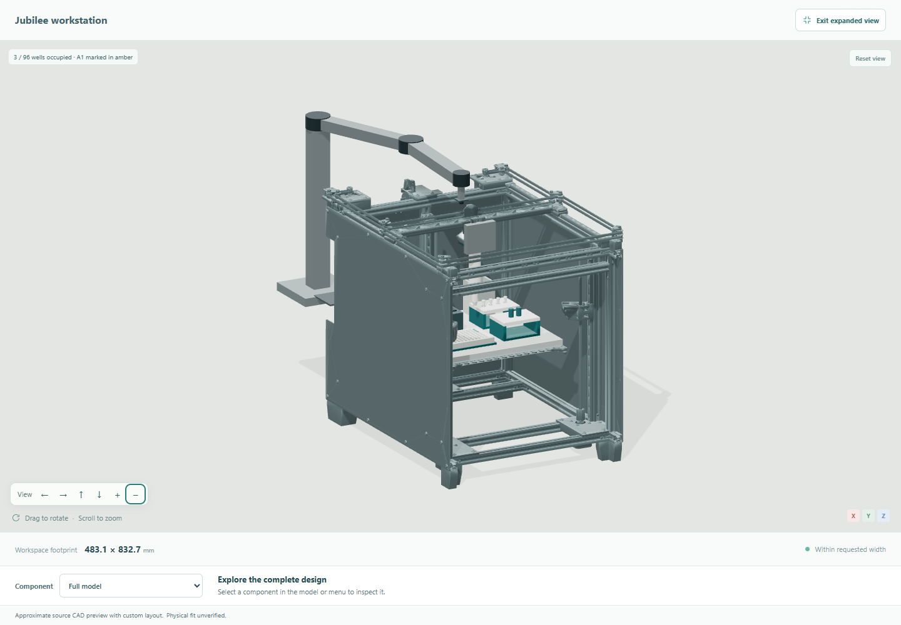

<p align="center">
  
</p>

# MuseAutoLab

**Design lab automation around your workflow.**

MuseAutoLab turns a conversation about repetitive laboratory work into a sourced,
editable automation proposal. Compare platforms, inspect the 3D layout, choose
parts and leave with a project guide you can actually work from.

The first engineering path is aliquots and dilutions. Start with the task;
volumes, labware and hardware choices come when they matter.

[**Try a saved project →**](#try-it-yourself) · [Explore the documentation](docs/README.md) · [See what has been checked](docs/verification.md)



*The running application: Jubilee source CAD with custom deck modules and an
inspection-arm concept. Physical fit and operation remain unverified.*

## From a task to a workable proposal

> “I spend a lot of time preparing aliquots and dilutions by hand.
> I want a flexible setup.”

You do not need a machine specification to begin. MuseAutoLab asks about the
process, materials, existing equipment, space and willingness to build. It brings
back alternatives with tradeoffs and waits for your platform choice before designing.

1. **Choose the foundation.** Compare a buildable Jubilee route with an assembled
   Opentrons OT-2 route. Neither is picked for you.
2. **Shape the setup in chat.** Revise a supported layout, describe a tube rack
   with measured dimensions, or ask to replace tubes with a 96-well plate.
   The 3D, parts and instructions follow the accepted revision together.
3. **See what the build involves.** Review US supplier listings in USD,
   separately labelled planning estimates, missing prices and route-specific
   sourcing and assembly steps. A partial subtotal stays a partial subtotal.
4. **Keep the design and change the recipe.** Review direct-dilution calculations,
   save a portable project, and download a protocol template and local schedule
   preview. The software guide explains where to take the protocol next.

Meta models handle the conversation and propose supported changes. Application
code checks arithmetic, compiles geometry and preserves the chosen source.
A rejected change leaves the accepted project intact.

## Two routes, different starting points

| | Jubilee | Opentrons OT-2 |
| --- | --- | --- |
| Starting point | Original, pinned source STEP from Machine Agency | Schematic enclosure and official deck software data |
| Design work | Custom insert/layout, dimension-driven racks, plate holder | Supported labware positions on the deck |
| What comes next | Source CAD, custom-part files and assembly guidance | Configuration, purchasing and setup guidance |

The Jubilee source solids stay unscaled. Its viewer meshes are simplified previews;
the original STEP remains the geometry authority. The OT-2 view is a schematic,
not imported manufacturer fabrication CAD.

For Jubilee, the supported modules also include a cold-bay concept and an explicitly
requested camera/inspection-arm concept. These still need interface and engineering
validation. Other laboratory tasks can produce a discovery brief; they do not
silently inherit the liquid-handling engineering path.

[Source and adapter details](docs/source-grounding.md) · [Jubilee CAD provenance](docs/jubilee-cad-asset.md)

## Try it yourself

**The easiest first look is a saved project.** The application runs locally;
there is no hosted demo to sign into.

1. Follow the [Windows setup](docs/getting-started.md#setup-on-windows-powershell)
   and [start the two local servers](docs/getting-started.md#run-locally).
2. Download the [recorded plate project](docs/examples/software-protocol-project.json)
   and choose **Open project**. Inspect its layout, preparation plan and guides
   without configuring a Meta key. The laboratory inputs are synthetic.
3. Open **Expand 3D view**, select a component and try **Selected part only**.
   Open **Software & protocols** to inspect the recipe independently of the machine.

To make a new proposal, add your own [server-side Meta configuration](docs/getting-started.md#local-meta-configuration),
choose **New project** and describe the work in ordinary chat. Spark/Wonder model
selection, editable Muse Voice dictation and optional Muse Image presentation
artwork are available through the configured account. Model-backed actions use
your allowance; generated artwork does not replace CAD.

[Full conversation walkthrough](docs/demo-guide.md) · [Recorded end-to-end flow](docs/presentation-flow.md)

<a id="setup-on-windows-powershell"></a>

## Run locally

The pinned toolchain is **Python 3.12.14 · uv 0.13.6 · Node.js 24.14.1 · npm 11.18.0**.
Windows x64 is the verified target. With those tools installed, a fresh checkout starts with:

```powershell
git clone https://github.com/SimoVice/MuseAutoLab.git
Set-Location MuseAutoLab
py -3.12 -m venv .venv
.\.venv\Scripts\python.exe -m pip install "uv==0.13.6"
.\.venv\Scripts\uv.exe sync --locked --all-extras
npm.cmd --prefix web ci
```

Then run each server in its own terminal from the repository root:

```powershell
.\.venv\Scripts\python.exe -m uvicorn app.api:app --host 127.0.0.1 --port 8000
```

```powershell
npm.cmd --prefix web run dev
```

Open [127.0.0.1:5173](http://127.0.0.1:5173/). Keep an existing `.venv` and synchronize
it rather than recreating it. The [complete setup guide](docs/getting-started.md)
includes version checks, a local npm fallback, safe `.env` setup and installation
verification. For chat-only use, the CAD/simulation extras are optional.

## What this prototype establishes

You can make and revise a digital proposal, inspect its source-bound geometry,
retrieve supported US catalog listings, generate build instructions and export
revision-specific project files. Jubilee exports include original source CAD,
custom parts, regeneration code and provenance; OT-2 exports provide schematic
layout and configuration guidance.

**It has not operated a laboratory machine.** Neither platform has a physics or
hardware-control adapter. Fit, tool access, mounting, calibration, liquid handling,
thermal performance and complete build cost still need verification. A protocol
preview prints a logical schedule; it does not command a robot. No measured
laboratory time saving is claimed.

Software checks, real model calls and supplier observations are recorded separately
in the [verification record](docs/verification.md). Older videos and screenshots
retain the scope of the version they show.

## Go deeper

- [Documentation map](docs/README.md) — choose a walkthrough or technical reference.
- [Software & protocols](docs/software-and-protocols.md) — reuse hardware and plan another recipe.
- [Pricing and build instructions](docs/procurement-and-instructions.md) — suppliers, assumptions and exports.
- [Development](docs/development.md) — regression checks, browser flows and locked dependency updates.
- [Third-party notices](THIRD_PARTY_NOTICES.md) and [software acknowledgements](docs/software-acknowledgements.md) — sources and their terms.

Jubilee is by Joshua Vasquez / Machine Agency, used under CC BY 4.0. Official
Opentrons software references retain their own attribution and terms. See the
notices before reusing source assets.
