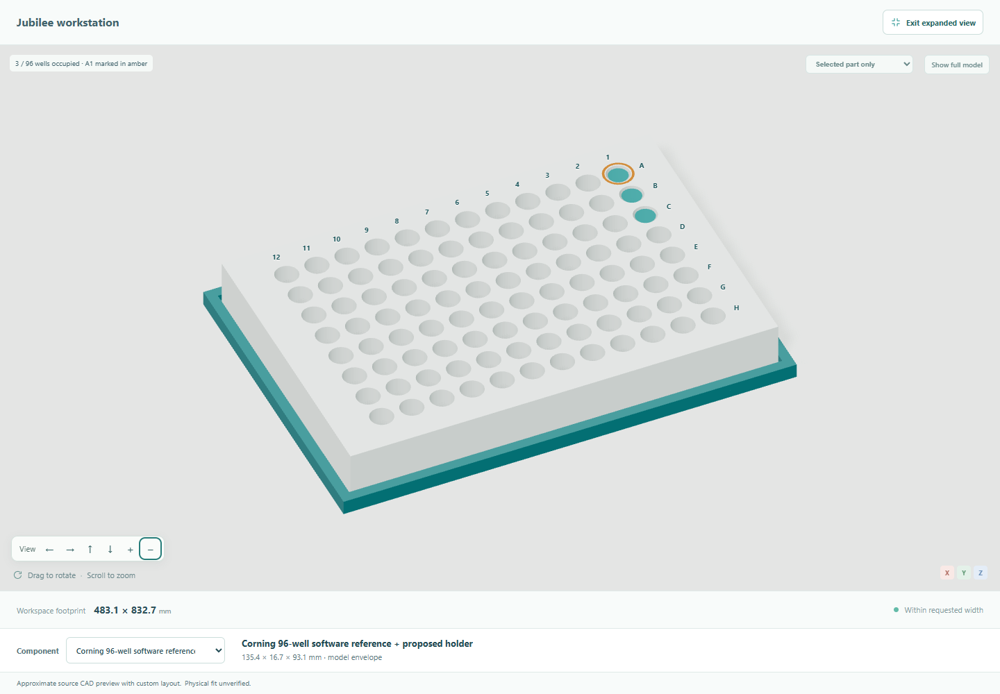
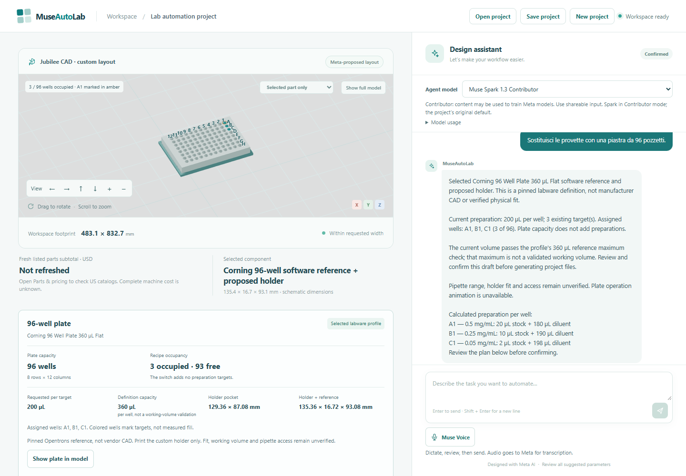

# MuseAutoLab

Turn repetitive laboratory work into a sourced, editable automation proposal through an engineering conversation.

Meta models interpret the researcher's request, propose checked layouts and design an optional inspection extension. The application retains the original source CAD and performs deterministic arithmetic, geometry compilation and checks. Coding assistants used to build MuseAutoLab are separate from its runtime Meta inference.

The current result is a **working digital prototype**: compare two reviewed platform routes, explicitly choose one, revise its supported geometry, save/reopen the project and generate coherent CAD/documents. The Jubilee route also supports a cold-bay concept, an explicitly requested inspection-arm/camera concept, a dimension-driven tube rack and a one-message switch to a named 96-well plate with a separate holder. Neither current platform has physics or hardware control; no laboratory performance or time saving has been measured.

**Start here:** [watch the three-minute demo](https://raw.githubusercontent.com/SimoVice/MuseAutoLab/main/docs/video/museautolab-demo.mp4) · [reviewer/demo guide and architecture](docs/demo-guide.md) · [delivery verification](docs/verification.md) · [locked setup](#setup-on-windows-powershell) · [run locally](#run-locally) · [offline checks](#verify-the-product) · [latest live Meta journey](docs/examples/delivery-third-rehearsal.json) · [source attribution](THIRD_PARTY_NOTICES.md).

The published 180-second video records the earlier core design journey with English captions. The product now also includes model selection, dictation, optional illustrations, US catalog pricing and immediate build instructions; the video will be updated after product verification. The guide includes the [recorded real-Meta project you can reopen without a key](docs/demo-guide.md#open-the-recorded-example-without-a-key), plus offline checks and the live product path, which requires your own Meta API access. The interactive product runs locally. Historical feature documents retain their original scope; use this README and the guide for the current flow.



**Inspect the current 3D:** use **Expand 3D view**, choose a component and select
**Selected part only** for a close view. Studio lighting, satin finishes and smooth
focus transitions make the source machine and custom modules easier to inspect.
Escape returns to chat. These are actual application renders; appearance does not
change engineering dimensions or specify fabrication materials. See the
[viewer walkthrough](docs/demo-guide.md#inspect-the-expanded-3d-view).

## Current demonstrator

The platform starts with the general laboratory problem. Aliquots and dilutions are the first complete digital engineering path; other tasks support discovery and a downloadable project brief. No concentrations, machine or future-module form are preset on the opening screen.

Meta collects needs such as throughput, equipment, available space, budget and willingness to assemble. It proposes sourced alternatives with reasons and tradeoffs, then waits for an explicit choice before generating 3D. The initial implemented catalogue has two different adapters:

- **Build open hardware:** the actual [pinned Jubilee STEP](https://github.com/machineagency/jubilee/blob/c877bd2e889560c83da2a68479641a4f7f0d9b83/frame/cads/STEP/jubilee.STEP), by Joshua Vasquez / Machine Agency, under CC BY 4.0. Its 809 source solids remain unscaled. Meta proposes a custom insert, component positions and a bounded digital bed pose.
- **Buy assembled:** an [Opentrons OT-2](https://opentrons.com/products/ot-2-robot) schematic using published enclosure dimensions and a pinned official software deck-slot definition. Meta assigns three labware proxies to distinct slots. No manufacturer machine CAD is imported; internal shapes, deck height, pipette and labware fit remain unverified. Obtain an official configuration/quote and check compatible instruments, labware and calibration.

Neither adapter is selected automatically. See [source provenance and reproduction](docs/jubilee-cad-asset.md), [source policy](docs/source-grounding.md) and [third-party attribution](THIRD_PARTY_NOTICES.md). This bounded catalogue is a working first implementation, not universal machine synthesis or a live supplier search.

This is a working software prototype for digital proposals, not a tested laboratory machine. Tool attachment, bed connections/travel, source/custom collisions, fabrication, electronics and liquid/thermal performance remain unverified. Science Jubilee controls are not installed. The imported platform has no MuJoCo adapter; legacy XYZ simulation results cannot validate it.

## Try the demo

1. Describe the problem: “I spend a lot of time preparing aliquots and dilutions by hand. I want a flexible setup.”
2. Discuss materials, equipment and constraints. For example: “I have a pipette and microcentrifuge tubes.” There is no need to choose concentrations yet.
3. Ask **“Compare an assembled platform with an open-source buildable one. Explain the tradeoffs and ask for my choice before designing.”** Answer Meta's next useful questions, then choose a route. For example: **“I prefer the open-source buildable one. Proceed with its design.”** The progress indicator follows the actual Meta/check request; its short final fill completes before accepted 3D appears.
4. Request a revision in chat, for example **“Lower the existing build plate by another 30 mm.”** for Jubilee, or **“Move only the sample rack to slot 8.”** for OT-2. Existing positions reach Meta as context. The compiler accepts or rejects a bounded proposal; it never silently rescales source parts.
5. On Jubilee, request any cold-bay/layout changes **before** expansion, inspect the full resulting footprint, then Save/Open the project and ask **“Now add an inspection arm and camera to this workstation.”** A new layout clears an earlier extension. Future examples do not add it. A separate custom sidecar is proposed; its sweep is kinematic, with no coverage, mounting or collision validation. Custom inspection/cooling integration on OT-2 is unsupported and rejected while preserving the accepted project.
6. Choose concentrations and final volume when useful: **“Use target concentrations of 1, 0.5 and 0.1 mg/mL, with a final volume of 1 mL per tube. Keep the machine layout unchanged.”** Per-tube wording is accepted as context, not an unsupported unit. If stock is missing, supply it when asked. With 10 mg/mL stock, stock volumes are 100, 50 and 10 µL respectively, each made up to 1 mL. These are example inputs, not defaults. Independent direct dilutions are calculated; capacity, pipette range, mixing and dead volume remain unchecked.
7. Open **Parts & pricing → Refresh US prices** for actual USD supplier listings, dated availability and partial-cost coverage. Ask **“How do I buy the pieces and assemble this?”** to open **Build instructions**: revision-specific steps, selected parts, official references and unresolved engineering tasks, with immediate HTML/Markdown/JSON downloads. Review the **Preparation plan**, confirm, then generate the full CAD package if needed. Photo inspection appears after an explicit request or accepted extension; only Analyze photo sends the selected image to Meta.

The left side contains the brief or interactive model, with a compact partial cost/selection summary. Secondary details stay collapsed. All development, cooling and expansion requests use the same chat; there are no permanent arm/camera/cooling request fields. A rejected change preserves the previous project. Quantity-only edits preserve the accepted layout, source/bed pose and inspection proposal. The generic sample-rack pattern follows preparation targets; a requested parametric rack retains its explicit capacity and rejects a preparation plan that exceeds it. Exports belong to the resulting revision. A new layout clears an earlier inspection extension so it can be designed against the new arrangement.

### A tube rack from declared dimensions

On an accepted Jubilee layout, ask in ordinary chat for a sample tube rack. Supply
the maximum body diameter through the hole, minimum supporting rim diameter,
maximum closed cap envelope including its hinge, underside-of-rim to tip length,
capacity and number of columns. Missing dimensions are requested; a nominal
**1.5–2 mL** label never becomes a guessed tube shape. Millimetres and centimetres
are supported. Capacity is bounded to 1–24 positions and 1–8 columns; footprint,
rim support, closed-cap separation and current preparation capacity are checked.

The result replaces only the sample rack, retaining the source machine and other
components. The viewer shows occupied tube envelopes at the actual hole centres.
Its card exposes dimensions and assumptions; the build guide supplies measurement,
printing, first-article fit and workstation-placement steps. The CAD package includes
one fused rack and a small matching fit coupon as separate STEP/STL files, alongside
the full workstation. Rack/material/printing costs remain unpriced. Save/Open retains
the dimensional sources and recompiles the module; older projects without a rack
retain their previous geometry.

These are digital checks against declared inputs and explicit FDM assumptions.
Actual tube fit, loaded stability, printer accuracy, cleaning, deck retention,
open-cap interference and pipette access remain unverified. Operating animation is
disabled for the custom rack until a matching tool-access adapter exists. The
current adapter does not generate custom OT-2 labware. See the
[rack specification and build guidance](docs/procurement-and-instructions.md#parametric-tube-rack).

**Inspect a real accepted example without a model call:** download the
[confirmed 12-position project](docs/examples/parametric-tube-rack-project.json)
and use **Open project** in the running app. Its dimensions are synthetic test
inputs. The [rack STEP](docs/examples/tube-rack/tube-rack.step),
[rack STL](docs/examples/tube-rack/tube-rack.stl) and
[fit-coupon STL](docs/examples/tube-rack/tube-rack-fit-coupon.stl) are also available
directly. [Verification](docs/verification.md#latest-module-dimension-driven-tube-rack)
records the initial failed live round, parser correction and successful regression.

### Switch from tubes to a 96-well plate

With an accepted Jubilee project, send **“Sostituisci le provette con una piastra
da 96 pozzetti.”** The sample module changes to the named Corning 360 µL flat
software reference and a custom holder. Existing preparations keep their volumes
and gain well addresses; three targets remain three, with 93 free wells. An
existing 200 µL preparation fits the reference maximum. A 2 mL preparation instead
produces a visible volume conflict and blocks confirmation until explicitly revised.

The model, source, part list, instructions and portable save change together.
**“Torna al portaprovette precedente.”** restores the stored rack dimensions and
position. Separate holder STEP/STL files are fabrication proposals; the plate STEP
is schematic reference geometry. Actual fit and liquid handling remain unverified.
See the [one-message demonstration and source/fit scope](docs/microplate-switching.md).

Open the [synthetic 200 µL tube setup](docs/examples/microplate-tube-setup.json)
to try that message, or the [confirmed plate project](docs/examples/microplate-project.json)
to inspect the result without new inference. [Small CAD downloads](docs/examples/microplate/README.md)
and [the test record](docs/verification.md#latest-module-one-message-96-well-plate-switch)
retain the source, actual checks and known limits.



Choose Spark Contributor, Spark Standard or Wonder above chat using the account-checked selector. **Muse Voice** transcribes a recording into an editable draft; review numbers and units, then explicitly send. With an accepted design, **Project details → Project illustration** generates an optional Muse Image presentation PNG from the actual 3D view, labelled as nontechnical artwork. These paths use real server-side Meta access and preserve the canonical project. See [model choice, dictation and illustrations](docs/multimodal-demo.md) for supported formats, cancellation, privacy, availability and limits.

Visible **Review preparation plan** and **Project files** shortcuts reveal the relevant section. Keyboard controls rotate/zoom the scene. A failed new-project request preserves the workspace; a successful reset offers **Undo new project**.

The fixed source envelope is approximately **483.1 × 612.7 × 564.4 mm** (width × depth × height). A width below 483.1 mm is rejected for this foundation. Meta may propose a **240–300 × 260–300 mm** custom insert and **95–150 mm** downward bed pose. These are bounded digital design choices, not validated travel or mounting limits. The camera/arm/cold sidecars add their own assembly bounds. Arbitrary CAD architectures and source-part editing are not implemented.

The OT-2 enclosure is **630 × 570 × 660 mm** (width × depth × height). Manufacturer instructions require **200 mm ventilation clearance around the instrument**, so the width check requires at least **1030 mm**. Other operating-space needs still require installation review. Exact labware capacities and throughput are not established by the schematic. Price, availability and delivery remain unknown; its checklist never inherits Jubilee's motors/frame BOM.

### Choose a supplier product or a printed tip holder

Ask **“Compare tip racks from different suppliers.”** On Jubilee, the conversation
offers reviewed TipOne and Opentrons references and asks about printer access.
Choosing a different product changes its source-bound openings/envelope, parts
record and instructions. Any required tip-rack translation is shown before
acceptance. With printer access confirmed, declared tip dimensions can produce
a custom holder and fit coupon for purchased tips. Unknown prices, fit and
unsupported products remain explicit. See the [tip-rack walkthrough](docs/tip-rack-options.md)
for exact scope, synthetic example inputs and checks.

## Save and export

**Save project / Open project** use a portable JSON file, capped at 256 KB, and rebuild canonical geometry without a Meta call. Compiler 4 retains engineering requirements, platform choice, source pose and accepted proposals; compiler 5 adds declared tube-rack inputs, and compiler 6 adds the pinned plate profile and reversible previous-rack state. Old projects retain their supported geometry. Files accept no arbitrary mesh URLs, CAD paths or executable code. Version-3 Jubilee designs retain geometry and acquire their existing platform choice. Version-1/2 files preserve inputs/history, clear incompatible designs/extensions and require a new design. New openings get a fresh runtime ID and retain lineage; old jobs/results are not restored. Browser-local resume is convenience, not cloud storage or a backup.

After confirmation, **Project details → Generate project files** performs real CAD, document and archive work. The package contains the full workstation STEP, custom deck STEP/STL, standalone build123d regeneration source, original source STEP gzip, license/provenance, source bindings, preparation/BOM data, assembly guidance and file hashes. The viewer uses simplified source meshes; the original STEP is the geometric authority. The SVG is a custom-parts layout view and omits source geometry. Simulation records `not_run` for this imported foundation.

When generation is ready, **Read project guide** opens the actual standalone HTML inside a sandboxed viewer; downloads remain available separately. A temporary status-request failure offers **Reconnect to generation**, which resumes checking the existing job instead of starting another heavy export.

Full source CAD exports are substantially larger/slower than the former concept boxes and can take several minutes on first use. Progress advances only after actual stages; it does not show invented percentages. Packages have a 128 MiB ZIP cap and 512 MiB uncompressed cap. Lightweight instruction downloads are available immediately. Full-package downloads are restricted to the current revision and bound procurement snapshot. A price refresh or expiry invalidates price-bearing old exports. Unknown costs remain unknown; listed parts are only a partial subtotal. See [US pricing and project instructions](docs/procurement-and-instructions.md) for supplier coverage, packs, freshness and download behavior.

OT-2 packages contain the schematic layout, configuration/setup guidance, quote checklist and licensed official deck data. They do not contain manufacturer fabrication CAD or executable robot protocols. Both selected-platform paths record simulation `not_run`; legacy XYZ physics cannot validate either instrument.

## Reproducible toolchain

| Tool | Pinned version | Purpose |
| --- | --- | --- |
| Python | **3.12.14** | Backend, CAD, physics and Python checks |
| uv | **0.13.6** | Locking and synchronizing the Python environment |
| Node.js | **24.14.1** | Frontend tooling |
| npm | **11.18.0** | Frontend installation from its lockfile |

Git is required to clone the repository. The first installation needs internet access and disk space for CAD dependencies. Environment checks make no model requests and need no API key. Native Windows x64 is the initial verification target; other operating systems are not claimed as tested.

All project Python packages belong in the root **`.venv`**. JavaScript packages belong in **`web/node_modules`**, the Node.js equivalent of a local dependency environment. Neither directory is committed. The setup below requires no global Python or npm package installation.

Version authorities:

- [`.python-version`](.python-version) and [`.node-version`](.node-version) pin interpreters.
- [`pyproject.toml`](pyproject.toml) pins direct Python dependencies; [`uv.lock`](uv.lock) locks the resolved graph and artifact hashes.
- [`requirements.txt`](requirements.txt) is a generated, hashed export including CAD, simulation and development packages. Do not edit it manually.
- [`web/package.json`](web/package.json) pins direct JavaScript packages and npm; [`web/package-lock.json`](web/package-lock.json) locks transitive versions and integrity.
- [`web/.npmrc`](web/.npmrc) enforces matching engines and exact dependency saves. Sources are the public PyPI and npm registries.

## Setup on Windows PowerShell

Install Python 3.12.14 and Node.js 24.14.1 first, with npm 11.18.0. These commands assume the Python launcher `py` is available; otherwise substitute the full path to Python 3.12.14.

```powershell
git clone https://github.com/SimoVice/MuseAutoLab.git
Set-Location MuseAutoLab

py -3.12 -c "import platform; assert platform.python_version() == '3.12.14'"
node --version
npm.cmd --version

py -3.12 -m venv .venv
.\.venv\Scripts\python.exe -m pip install "uv==0.13.6"
.\.venv\Scripts\uv.exe sync --locked --all-extras

Push-Location web
npm.cmd ci
Pop-Location
```

Use `npm.cmd` to avoid PowerShell script-policy issues. Activation is optional: explicit executable paths select the environment without changing the system execution policy. Preserve an existing `.venv`; synchronize it instead of recreating it.

If the installed npm version differs, bootstrap the pinned CLI locally from the repository root, then repeat the frontend commands. This changes only the current shell's search path:

```powershell
npm.cmd install --prefix .local/npm-cli --no-save --package-lock=false --ignore-scripts --no-fund "npm@11.18.0"
$localNpmBin = (Resolve-Path .local/npm-cli/node_modules/.bin).Path
$env:Path = "$localNpmBin;$env:Path"
npm.cmd --version
```

Repeat the search-path assignment in a new shell if using this local CLI. Do not run a global npm upgrade as part of reproduction.

`uv sync --locked --all-extras` includes the backend, CAD, simulation and default development group. For chat-only use, omit `--all-extras`; project-file generation and the full checks below require both CAD and simulation extras. MuJoCo 3.17.0 remains pinned. Camera image processing adds Pillow 13.0.0 as a direct requirement (already present transitively in the CAD environment).

For an unreliable connection, retry with lower concurrency while preserving the lock:

```powershell
$env:UV_CONCURRENT_DOWNLOADS = "3"
$env:UV_HTTP_TIMEOUT = "120"
.\.venv\Scripts\uv.exe sync --locked --all-extras
```

The uv cache stays in ignored `.local/uv-cache`. Setup does not modify a populated `.env`.

### Other operating systems

With the same tool versions, use `python3.12 -m venv .venv`, `.venv/bin/python -m pip install "uv==0.13.6"`, `.venv/bin/uv sync --locked --all-extras`, and `npm ci` inside `web`. Platform-specific dependencies and OpenGL drivers still need verification.

## Verify the installation

Run from the repository root:

```powershell
.\.venv\Scripts\uv.exe lock --check
.\.venv\Scripts\uv.exe pip check
.\.venv\Scripts\python.exe scripts\check_environment.py
.\.venv\Scripts\ruff.exe check scripts

Push-Location web
npm.cmd ls --all
npm.cmd run check:environment
Pop-Location
```

The Python check verifies virtual-environment isolation and direct versions, exports/reopens a small STEP solid, and advances a minimal MuJoCo scene on the CPU. The frontend check compares installed versions with the manifest/lockfile and performs headless React/R3F/Three.js imports. Expected result: `"status": "passed"` from both scripts and successful dependency checks.

These are **environment checks**. They do not launch the product, test browser/WebGL rendering, validate a workstation cycle or verify a laboratory result. The temporary CAD solid is removed automatically. No API key is loaded and no inference is sent.

Verified on 2026-10-27 on Windows x64: the primary environment and a separate clean reconstruction passed the Python/CAD/physics and frontend checks. The reconstruction installed from unchanged lockfiles, also accepted the hashed requirements export, and preserved the original configuration without copying credentials. This verifies the dependency baseline, not full application reproducibility.

## Local Meta configuration

Create the local file without overwriting an existing configuration:

```powershell
if (-not (Test-Path -LiteralPath .env)) {
    Copy-Item -LiteralPath .env.example -Destination .env
}
```

| Variable | Template value | Purpose |
| --- | --- | --- |
| `MODEL_API_KEY` | Empty | Your own Meta Model API key |
| `META_API_BASE_URL` | `https://api.meta.ai/v1` | Provider endpoint |
| `META_MODEL` | `muse-spark-1.3-contributor` | Default for suitable tests |

The backend reads these variables; environment verification does not use them. Keep credentials server-side and out of browser bundles. Never commit `.env` or put an API key in a `VITE_` variable.

Contributor is the default for suitable tests; use `muse-wonder-1.0` when complexity or an observed quality failure justifies it. Account/model access and billing are external prerequisites. Contributor inputs/responses may be used for training: use shareable or synthetic inputs. Model access is not included in dependency setup.

## Locked dependency groups

| Group | Direct packages |
| --- | --- |
| Backend | FastAPI 0.162.0, Pydantic 2.14.1, HTTPX 0.28.1, python-dotenv 1.2.4, Uvicorn 0.54.0, Pillow 13.0.0 |
| CAD extra | build123d 0.13.0, matplotlib 3.11.2 |
| Simulation extra | MuJoCo 3.17.0 |
| Python development | Playwright 1.64.1, pytest 9.1.1, Ruff 0.17.3, uv 0.13.6 |
| Frontend | React/React DOM 19.3.1, React Three Fiber 9.8.2, Drei 10.7.9, Three.js 0.186.1 |
| Frontend development | Vite 8.3.5, React plugin 6.1.2, TypeScript 7.0.2, Tailwind/Vite plugin 4.3.3; exact type packages in the manifest |

## Run locally

After setup and local `.env` configuration, run in two PowerShell terminals:

```powershell
.\.venv\Scripts\python.exe -m uvicorn app.api:app --host 127.0.0.1 --port 8000
```

```powershell
Set-Location web
npm.cmd run dev
```

Open http://127.0.0.1:5173/. The frontend proxies `/api` to the backend. Meta requests consume the configured allowance; credentials stay in the backend. Active sessions and generated jobs are process-local. Stop each server with Ctrl+C; save the project first if needed.

## Verify the product

```powershell
.\.venv\Scripts\python.exe -m pytest -q --ignore=tests/test_foundation_exports.py
.\.venv\Scripts\python.exe -m pytest tests/test_foundation_exports.py -q
.\.venv\Scripts\ruff.exe check app tests scripts
npm.cmd --prefix web run build
.\.venv\Scripts\python.exe tests/browser_foundation.py
.\.venv\Scripts\python.exe tests/browser_engineering.py
.\.venv\Scripts\python.exe tests/browser_platform.py
.\.venv\Scripts\python.exe tests/browser_vision.py
.\.venv\Scripts\python.exe tests/browser_scene_focus.py
.\.venv\Scripts\python.exe tests/browser_project_files.py
.\.venv\Scripts\python.exe tests/browser_multimodal.py
.\.venv\Scripts\python.exe tests/browser_scene_accessibility.py
.\.venv\Scripts\python.exe tests/browser_resources.py
.\.venv\Scripts\python.exe tests/browser_labware.py
.\.venv\Scripts\python.exe tests/browser_microplate.py
.\.venv\Scripts\python.exe tests/browser_presentation.py
```

The first Python command runs the regular regression suite; the second runs the source-CAD checks, including a full export/reopen and standalone regeneration. That integration test reads expanded source geometry twice and requires substantial time and memory (several GiB on the verified Windows host). Run it separately from quick UI iteration. Both check sets are required for source/export changes.

The current Chrome flow uses explicit offline Meta fixtures, the real API/compiler and real locally served Jubilee meshes. It checks discovery without presets, future examples without action, progress-before-reveal, chat design/revision/expansion, width rejection/rollback, late dilution arithmetic, confirmation, collapsed details, saved/reopened state and mobile layout. Set `MUSEAUTOLAB_BROWSER_SCREENSHOT` to an absolute path for an optional screenshot. It does not establish physical operation.

`browser_engineering.py` checks comparison, no CAD before selection, both actual adapter routes, the exact per-tube prompt, unchanged layout, setup guidance and save/reopen. `browser_smoke.py` and the former design/evolution/source entry points delegate to the foundation flow. `browser_platform.py` checks generic discovery/workflow switching; `browser_vision.py` retains photo/review/archive/camera-track scenarios. Legacy direct `/design` endpoints/compiler fixtures remain for compatibility testing; current `/messages` development requires an explicit platform choice.

`browser_project_files.py` uses explicit offline export responses to check both platform labels, reconnect after an interrupted status request without another export POST, explicit sandboxed guide reading and project reset. It does not generate heavy CAD or call Meta.

`browser_resources.py` checks pricing coverage, failed refresh recovery, expiry and
focus/visibility rereads without automatic supplier calls, candidate/source labels,
instruction navigation, real document download, revision/report guards, saved-project
reopening and mobile layout. Catalog responses are controlled fixtures; the separate
[live supplier and Meta record](docs/examples/procurement-instructions-verification.json)
contains actual observations.

`browser_microplate.py` checks a tube-to-plate message, occupied well addresses,
volume conflicts, rejected requests, rack restoration, portable recovery and
mobile layout. Its model responses are explicit offline fixtures. The separate
[microplate evaluation record](docs/examples/microplate-verification.json) retains
the actual Meta calls, failures, corrections and CAD/API responsiveness measurements.

The shareable [live Meta example](docs/examples/chat-foundation-live.json) records synthetic future-example, source-layout, bed revision and inspection requests. It distinguishes actual model choices from deterministic checks and preserves rejection evidence. Results are nondeterministic and are integration checks, not model accuracy or laboratory validation.

## Boundaries

Implemented: general discovery, bounded Meta liquid-workstation/inspection proposals, imported source CAD, checked custom geometry, direct-dilution calculations, interactive 3D, optional real-photo analysis with human review, local portable state and revision-specific exports.

Not implemented: arbitrary robot synthesis, fabrication-ready custom interfaces, calibrated hardware control, pipetting/temperature validation, arm dynamics/collision simulation, full Jubilee physics, automated ordering or a complete priced/verified machine BOM. US catalog retrieval and source-grounded instruction generation are implemented; compatibility gaps remain explicit engineering tasks. Optional Muse Image output is presentation artwork and may alter details. Photo detections are image regions, not calibrated world coordinates or measured volumes. Historic live checks and screenshots in older documents describe their recorded version; this README and the current source asset documentation describe today's interface.

## Updating requirements deliberately

Normal reproduction uses `sync --locked` and `npm ci`, preserving the selected graph. To change dependencies, update exact direct pins intentionally, regenerate locks, rerun checks and review the diff together:

```powershell
.\.venv\Scripts\uv.exe lock
.\.venv\Scripts\uv.exe sync --locked --all-extras
.\.venv\Scripts\uv.exe export --locked --all-extras --format requirements-txt --output-file requirements.txt

Push-Location web
npm.cmd install --package-lock-only --ignore-scripts
npm.cmd ci
Pop-Location
```

Alternatively, install the hashed export with `.\.venv\Scripts\uv.exe pip sync --require-hashes requirements.txt` in the pinned Python environment. `uv.lock` remains the authority. Regenerate the export whenever the Python graph changes.

Do not use unpinned installs, `npm update`, automatic upgrades or an unrecorded global package to repair a reproduction failure.
