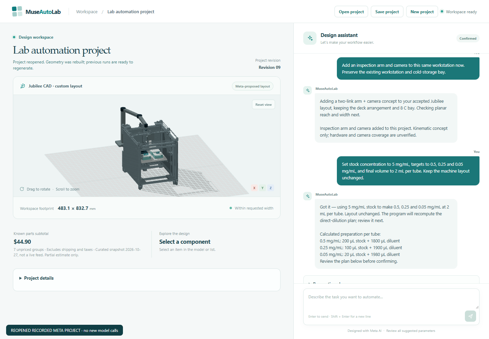
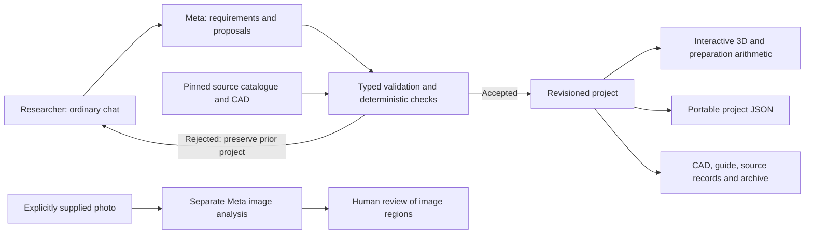

# Reviewer and demo guide

Current product path, updated **2026-10-31**. MuseAutoLab helps a researcher turn
repetitive laboratory work into a sourced, editable automation proposal. The first
engineering demonstrator is dilution and aliquot preparation. The result is a
digital project with consistent geometry, calculations, source attribution and
revision-specific files. No laboratory performance or time saving has been measured.

## Choose how to review

| Path | What you can inspect | Requirements |
| --- | --- | --- |
| Watch the core demo | [Three-minute MP4](https://raw.githubusercontent.com/SimoVice/MuseAutoLab/main/docs/video/museautolab-demo.mp4), recorded core product journey with English captions | No account or API key; latest pricing/instruction features are described below |
| Read without installing | This guide, architecture below, source documentation and dated JSON examples | No account or API key |
| Inspect the 96-well switch | [Confirmed plate project](examples/microplate-project.json), [small holder/reference CAD](examples/microplate/README.md) and [actual test record](examples/microplate-verification.json) | CAD and screenshots need no setup; reopen in the local app without inference |
| Inspect the new tube rack | [Confirmed project](examples/parametric-tube-rack-project.json), [rack STEP](examples/tube-rack/tube-rack.step), [rack STL](examples/tube-rack/tube-rack.stl) and [fit coupon](examples/tube-rack/tube-rack-fit-coupon.stl) | CAD downloads need no account, setup or inference; the interactive viewer needs the local app |
| Reopen a recorded project | Real 3D, accepted layout, cold bay, inspection sweep and local exports from the example below | Locked setup and local servers; no Meta key or new inference |
| Run offline checks | Actual application/compiler/browser with explicitly substituted Meta responses | [Locked setup](../README.md#setup-on-windows-powershell), local Chrome for browser checks; no key or live inference |
| Use the product with Meta | Natural conversation, platform choice, design and revisions | [Local configuration](../README.md#local-meta-configuration), your own account access/allowance, then [two local servers](../README.md#run-locally) |

The interactive product runs locally. Offline fixtures test software behavior;
they are not fresh model responses. A saved project rebuilds
locally without inference but does not restore export jobs or authenticate imported
historical model metadata.

## One-message labware change

The Jubilee sample module can change from the stored tube rack to a named
96-well plate through the same chat. Start with a synthetic 200 µL preparation
in tubes, focus the rack, and send **“Sostituisci le provette con una piastra da
96 pozzetti.”** Inspect the new 8 × 12 array, A1 marking, occupied wells and updated
build instructions. Existing target count and liquid amounts are retained. Ask
**“Torna al portaprovette precedente.”** to restore the prior rack.

The named reference is based on pinned Opentrons software data, not manufacturer
CAD or measured fit. A format-only switch from a 2 mL recipe stays a draft with
a volume conflict. See [the demonstration sequence and scope](microplate-switching.md).
The video has not yet been updated to include this feature.

For a reproducible starting point, open the [synthetic 200 µL tube setup](examples/microplate-tube-setup.json)
in the running app. The quantity-only setup was prepared deterministically from
the recorded rack project; its older conversation still mentions the earlier 2 mL
recipe. The current preparation plan is authoritative. Sending the switch message
requires Meta access. Alternatively, open the [confirmed plate result](examples/microplate-project.json)
without a key and choose **Show plate in model → Selected part only**. This is the
actual accepted result of a real Contributor request, subsequently confirmed.

## Inspect the parametric rack

The new [confirmed rack project](examples/parametric-tube-rack-project.json) is
revision 12, compiler 5. It extends the earlier Jubilee project using a real Meta
response to **synthetic** dimensional inputs. Open it through **Open project** in
the running application, then choose **Show rack in model** in the rack card.
There are twelve holes in three rows and four columns, with three preparation
targets and nine free positions. The guide uses the same dimensions and revision.
No new inference is needed to inspect, save/reopen or export this result.

The [small CAD artifacts and hashes](examples/tube-rack/manifest.json) are available
directly so a reviewer can inspect the useful output before installing the entire
application. Follow the [measurement and first-article guidance](procurement-and-instructions.md#parametric-tube-rack).
These inputs do not establish fit to a commercial 1.5–2 mL tube. Printed fit,
material suitability, deck retention and pipetting are unverified; the custom
rack has no operating-animation adapter.

The [verification record](examples/parametric-rack-verification.json) preserves
the failed first live round and successful corrected regression. This is bounded
digital integration evidence, not independent model benchmarking or human time saved.

## Open the recorded example without a key

The [portable video project](examples/demo-video-project.json) is a synthetic preparation project
saved from a successful **real Contributor browser rehearsal on 2026-10-30**, compiler 4,
revision 9. It contains the original Jubilee source identity, a 120 mm digital bed
drop, a requested 8 °C cold-bay concept, an inspection-arm/camera proposal and a
confirmed three-target dilution plan. It is recorded model output, not a new response
or a physical test. The temperature is requested, not measured.

Real app view after reopening the recorded synthetic Meta result. This capture made
no new inference; it shows the digital proposal, not assembled laboratory hardware.

1. Follow the [locked setup](../README.md#setup-on-windows-powershell), then start the
   [two local servers](../README.md#run-locally). An API key and `.env` are unnecessary
   for this recorded-project review.
2. In the app, choose **Open project** and select `docs/examples/demo-video-project.json`
   from the checkout. Geometry is rebuilt locally; the new runtime ID differs from
   the historical saved project ID while revision/lineage remain available.
3. Rotate the model, open **Project details**, select a component and use **Inspect
   view** to isolate the selected part, working area or arm/camera. **Show full model**
   returns to the whole assembly. Inspect the separate kinematic sweep if useful.
4. Open **Parts & pricing** and explicitly refresh US prices for current supplier
   observations. Open **Build instructions** for the immediate revision-specific
   guide and HTML/Markdown/JSON downloads. Neither requires Meta inference; only
   the explicit price refresh contacts suppliers. See [pricing and instruction scope](procurement-and-instructions.md).
5. Choose **Generate project files** to create an actual local package from the
   reopened state. This uses local CAD/document generation, not Meta. The heavy
   source export can take several minutes. Read the guide and download the ZIP after
   the job is ready; historical export jobs are not restored.

Conversation edits or fresh model proposals require separately configured Meta
access and allowance. Opening the example does not authenticate the historical model
metadata supplied in that file. Its scope remains a digital engineering proposal;
neither cooling nor the inspection module is hardware-validated.

This example uses 5 mg/mL stock, targets of 0.5/0.25/0.05 mg/mL and 2 mL final volume
per tube, producing 200/100/20 µL stock amounts. The earlier
[October 29 example](examples/demo-project.json) remains available with its original
130 mm / 4 °C / 100-50-10 µL values. These are different recorded projects, both at
revision 9; do not combine their evidence.

## What Meta does

Meta interprets the task, extracts grounded requirements, proposes sourced platform
options and reasons, and proposes bounded layouts/revisions. On the Jubilee route,
it can propose inspection-arm dimensions after an explicit request. The application
supplies the supported architectures, source catalogue, arithmetic, geometry compiler,
checks and acceptance rules. Imported Jubilee geometry was not invented by Meta.
Development coding assistants are separate from these runtime requests.

The current Jubilee and OT-2 routes have **no physics or hardware-control adapter**.
Their packages record simulation `not_run`. An operating animation, a kinematic arm
sweep, geometric checks and photo observations are distinct digital outputs.

## Rehearse the main journey

Use the ordinary chat throughout. Prompts below are synthetic examples, not commands
that force an outcome. Actual Meta wording, latency and choices vary.

1. **Start with the problem.** “I spend a lot of time preparing aliquots and dilutions
   by hand. I have a pipette and microcentrifuge tubes.” Discuss the needs that affect
   the choice, including space and willingness to assemble. Choose quantities later.
2. **Compare and choose.** “Compare an assembled platform with an open-source buildable
   one. Explain the tradeoffs and ask for my choice before designing.” Then explicitly
   select Jubilee for this design/revise/expand demonstration. No platform is automatic.
3. **Inspect the design.** The accepted proposal reveals actual source CAD plus custom
   insert/layout. Select parts and inspect the recorded model, rationale and checks.
   Jubilee's fixed frame stays approximately 483.1 × 612.7 × 564.4 mm; changing the insert
   or bed pose does not shrink that frame.
4. **Revise visibly, then add cooling.** For example, “Lower the existing build plate
   by another 30 mm.” Request the cold-bay concept in chat and inspect the accepted
   geometry and full sidecar footprint. Cooling is a digital concept, without measured
   temperature control. A 450 mm overall-width request is a rejection example.
5. **Save and reopen, then expand.** Save/Open the accepted project, then ask “Now add
   an inspection arm and camera to this workstation.” Finish layout/cooling changes
   first: a new layout clears an earlier extension. The sidecar and sweep are a bounded
   kinematic concept; mounting, collisions, loads and camera coverage are unverified.
6. **Choose a preparation.** For example, supply 10 mg/mL stock, targets 1, 0.5 and
   0.1 mg/mL and 1 mL final volume per tube, preserving the layout. The deterministic
   direct-dilution calculation gives 100, 50 and 10 µL of stock. Missing stock must be
   asked, not inferred. Pipette range, capacity, mixing and dead volume are unchecked.
7. **Confirm and generate.** Review the Preparation plan, confirm, then open Project
   details and Generate project files. Progress follows completed work. Full Jubilee
   source-CAD export can take several minutes. Read the actual guide, inspect downloads
   and verify that the package revision matches the final accepted project.

A failed or unsupported change should preserve the accepted project. Quantity-only
edits preserve the accepted layout, source/bed pose and inspection proposal. The custom
sample-rack hole pattern follows the number of preparation targets; exports remain
revision-specific. Analyze photo is a separate explicit image-upload action;
virtual camera placement is not a real photograph or automatic inspection.

## The two routes are different

| | Jubilee open-hardware route | OT-2 assembled route |
| --- | --- | --- |
| Source | Original pinned STEP, 809 unscaled solids, CC BY 4.0 | Schematic enclosure and official pinned deck-slot software data; not manufacturer CAD |
| Meta design choices | Bounded insert/layout and digital bed pose | Three labware proxies in distinct deck slots |
| Supported demo revisions | Bounded layout/bed, cold-bay concept, inspection sidecar | Bounded slot assignments; custom cooling/inspection rejected |
| Guidance | Source build/BOM references plus unresolved tooling, actuation, mounting and calibration work | Configuration/quote, compatible instrument/labware and setup checklist |
| Exports | Source-based assembly, custom geometry, provenance, documents | Schematic assembly, licensed deck data and setup documents; no executable robot protocol |
| Limits | No build-ready interface, travel or source/custom collision proof | No verified internal fit, capacity or throughput; ventilation/setup review required |

Neither route provides a complete priced procurement list or laboratory-ready protocol.
See [source policy](source-grounding.md), [Jubilee asset reproduction](jubilee-cad-asset.md)
and [third-party notices](../THIRD_PARTY_NOTICES.md) for source identity and rights.

## Evidence and verification scope

The [multimodal walkthrough](multimodal-demo.md) covers the implemented account-checked
Spark/Wonder selector, editable Muse Voice dictation and optional Muse Image
illustration. The [curated verification appendix](examples/multimodal-verification.json)
retains real request outcomes, failures and fixes. Agent usability checks improved
reset recovery, keyboard view controls, mobile layout and discovery of plans/files.
They are separate from the earlier core journey and from testing with external users.

| Record | Date and scope |
| --- | --- |
| [Third complete live browser journey](examples/delivery-third-rehearsal.json) and [video project](examples/demo-video-project.json) | 2026-10-30; real browser conversation, third fresh completion and a live 450 mm rejection preserving the confirmed state; distinct from the earlier example below |
| [Delivery verification](verification.md) | 2026-10-30; 539 regular tests and eight offline browser flows after multimodal fixes; historical source-CAD/reconstruction and actual revision-9 package evidence remain separately dated |
| [Initial complete-path Meta rehearsals](examples/delivery-rehearsal-summary.json) | 2026-10-29, curated October 30; two complete fresh journeys, a recovered journey and failed/incomplete attempts; retained unchanged, with the third fresh completion recorded separately above |
| [Three-minute video](video/README.md) | 2026-10-30; 180 s, 1080p30, synthetic English narration and timed captions; final media checks and labelled cuts in the video record |
| [Current platform-choice example](examples/engineering-choice-live.json) | 2026-10-29; actual Contributor responses on synthetic needs, both routes and late quantities; retains earlier failures and reported usage |
| [Source-CAD chat example](examples/chat-foundation-live.json) | 2026-10-28; actual Contributor source-layout, bed and inspection requests, with rejection evidence; predates the current needs/choice flow |
| [Historical layout implementation](meta-design.md) and [project evolution](project-evolution.md) | 2026-10-28; older architecture/UI records, not instructions for today's interface |
| [Product-check commands](../README.md#verify-the-product) | Reproducible checks, explicitly separated into regular, heavy source export and offline browser scopes |

These examples document particular integration runs, not a benchmark, current release
certificate, physical experiment or reliability percentage. Run the relevant checks
against the revision under review. The video is available publicly; authenticated
form requirements and actual event submission remain separate delivery steps.
