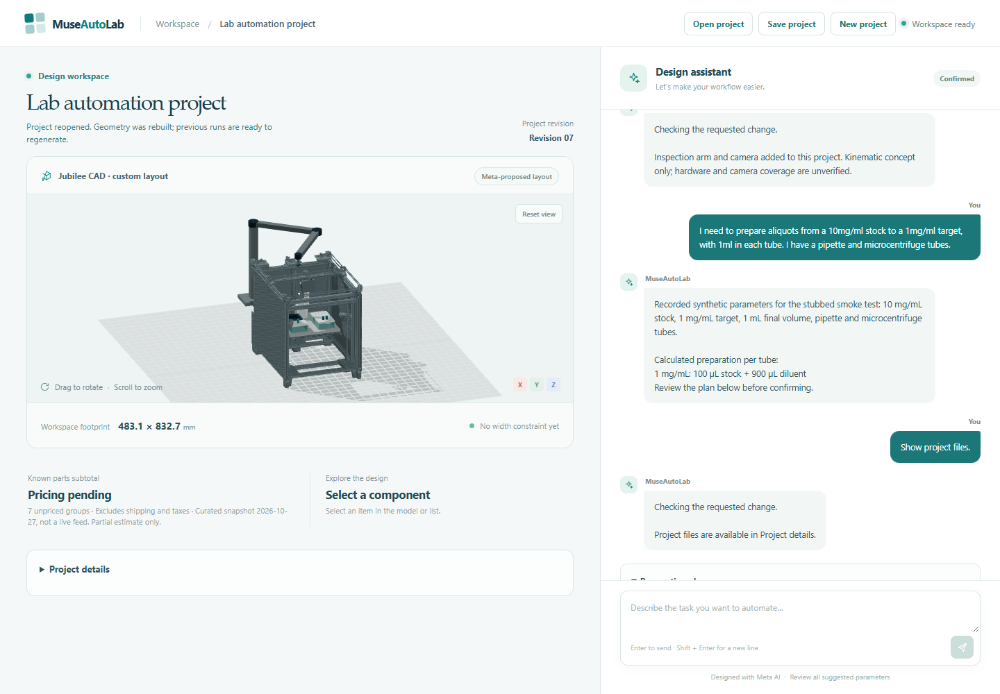

# Jubilee source assembly



Actual application screenshot with explicit offline model fixtures. Source meshes,
the API, geometry compilation and saved/reopened state are real; the screenshot
is not a live Meta or hardware result. Live synthetic model outputs are recorded
separately in [the chat example](examples/chat-foundation-live.json).

The pinned, losslessly compressed Jubilee V2.2.2 STEP in `app/assets` is the
upstream work by Joshua Vasquez / Machine Agency, University of Washington,
licensed CC BY 4.0. The adjacent license and provenance manifest give the exact
revision, URLs, checksums, measured envelope, and modifications. Include both
with any redistribution or exported assembly that includes this geometry.

The viewer uses two approximations tessellated from that STEP: the static root
children and the upstream `build_plate_assembly`. The latter can move down by
0–150 mm as a bounded digital proposal; this does not establish a physical
travel limit, connecting mechanism, fit, or collision-free motion. The rest of
the source assembly retains its original geometry and positions. The original
STEP remains the CAD source, and the preview may omit small features; neither
view is evidence of a working machine. User-added fixtures and tools are
separate concepts and their interfaces are unverified.

## Verified full export

The synthetic integration fixture produced a 396,887,598-byte expanded workstation
STEP and 408,150,757 bytes of CAD/source files. Its CAD-only ZIP was 80,215,348 bytes,
below the 128 MiB archive cap; the uncompressed set was below the 512 MiB cap. Other
layouts/modules can change these sizes. The compact native-reference writer
attempted during development did not preserve the changed bed pose after reopening
and is not used.

The full eight-test source suite passed in 703.10 seconds on the tested Windows
host. It reopened the actual STEP, checked validity, solid count, source and bed
bounds, executed the standalone regeneration script, reopened that output and
rechecked the bed. A changed source gzip was rejected by its raw STEP hash. These
are digital geometry checks, not mechanical travel, mounting or collision tests.

## Reproduce the viewer meshes

To regenerate the viewer assets, install the repository's locked Python and
web dependencies, then from the repository root run:

```
python scripts/prepare_jubilee_mesh.py
node scripts/simplify_jubilee_mesh.mjs static
node scripts/simplify_jubilee_mesh.mjs bed
```

These commands write scratch files in `.local/upstream-cad`. Compare their
hashes and bounding boxes to the manifest before replacing distributed assets.
The simplifier uses the meshoptimizer package present in the web dependency
lock, and the measured preview error is an approximation, not a manufacturing
tolerance. The source STEP and attribution must accompany downstream use.
