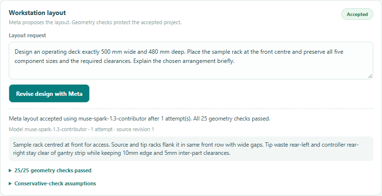
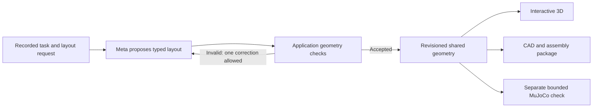

# Meta-proposed workstation layouts

MuseAutoLab turns a laboratory task into a revisioned workstation proposal. The
liquid preparation adapter now has a bounded design agent: the configured Meta
model chooses operating-deck dimensions and component positions, while the
application checks and compiles that proposal into actual 3D/CAD geometry.

This feature operates on the existing workstation project. It does not generate
arbitrary robots or validate hardware. A separate bounded
[inspection extension](project-evolution.md) adds a digital arm/camera to an accepted layout.
The backend retains a built-in parametric workstation as the compiler's reference
architecture. It is not a Meta-generated machine. The UI does not render that
reference just because the task was classified: the first viewer appears only
after an explicit model layout proposal passes its checks.



The screenshot records a real synthetic-input browser run. The model identifier,
accepted revision's source and check summary come from the actual response.
Examples and measurements below are small integration checks, not a model ranking.

## Runtime responsibilities



| Responsibility | Implementation |
| --- | --- |
| Requirement interpretation and workflow classification | Meta through `app/model_client.py` |
| Layout dimensions, component placement and short rationale | Meta through `app/design_agent.py` |
| Schema, width, margins and footprint separation | `app/design_spec.py` |
| Shared primitive geometry and CAD | `app/geometry.py`, `app/cad_exports.py` |
| Confirmation, revisions and exports | `app/domain.py`, `app/project_exports.py` |
| Motion/contact computation under declared assumptions | `app/physics.py` |
| Still-photo observations and human correction | `app/vision.py`, `app/vision_jobs.py` |

The default runtime model is `muse-spark-1.3-contributor`, read from the existing
server-side configuration. No image/audio model is called by this feature.
Development assistants and their skills are not product runtime dependencies.

## Try a real design

Follow the root README's locked setup and configure your own Meta Model API key.
Begin with the problem, without quantities:

> I spend a lot of time preparing aliquots and dilutions by hand. I want help
> designing a flexible setup for this work.

Discuss the process and equipment with Meta. Then define the preparation together:
available stock, desired target concentrations and final volumes. You can choose
different values for each project and revise them through chat; no concentration
or volume is selected by the opening. Ask Meta to explain the required inputs if
you have not chosen them yet.

The [recorded synthetic conversation](examples/generic-entry-live.json) shows a
real three-turn browser check: generic problem, later stock only, then the user's
chosen targets and volume. Example numbers are not defaults or recommendations.

Only later, as a synthetic example, you might choose a 10 mg/mL stock, a 1 mg/mL
target and 1 mL per tube, using a pipette and microcentrifuge tubes. These values
are an optional example, not a preset or a prerequisite for starting the chat.
If you want the geometric example below, set the maximum width to at least 500 mm.

Once equipment is recorded, **Workstation layout** becomes available. Before that,
the UI remains in planning without a 3D machine or prices. In the panel, enter:

> Design an operating deck exactly 500 mm wide and 480 mm deep. Place the sample
> rack at the front centre and preserve all five component sizes and the required
> clearances. Explain the chosen arrangement briefly.

Choose **Develop design with Meta**. A valid proposal changes the displayed
geometry and creates a draft revision. Confirm again before running physics or
generating project files. The operating deck excludes the appended cold bay.
Before the first accepted proposal there is no viewer. Concentrations/volumes can
be planned beforehand, but confirming the machine also requires an accepted
layout. A repeated welcome is not part of the model's intended first reply: the
interface has already asked the opening question.

No model request happens merely by opening the panel. Requirements chat and
layout design are separate actions. Chat/configuration changes rebuild the
baseline and invalidate the previous accepted layout; develop a new layout after
those changes. The invalidated viewer and its dependent panels are hidden until
then. A rejected candidate preserves the last accepted layout. Confirmation
preserves it. Projects remain process-local.

## Supported design and failure behavior

- Custom operating deck: 400–900 mm wide, 320–650 mm deep, subject to the recorded
  maximum workspace width. Custom crossbar and frame positions follow it.
- Five movable components: source rack, sample rack, tip rack, waste and
  controller. Their existing sizes and stable IDs cannot be changed by the model.
- Checks: valid finite typed input; correct component identities; 10 mm deck-edge
  margins; 5 mm separation in x or z between movable envelopes; and an 85 mm rear
  gantry strip. These are conservative 2D checks, not complete mechanical checks.
- Maximum two model attempts: the initial proposal and one diagnostic correction.
  Rejected runs leave geometry, revision and confirmation unchanged. Network or
  incomplete-response failures stop without silently substituting a layout.
- Requests are serialized per project, check the expected revision and limit
  concurrent design work to two per event loop. Individual model calls have a
  45-second limit; the active attempt loop has a 90-second budget. No general
  CAD code or shell command is executed from model output.
- Full accepted proposal, supplied instruction, actual model ID, checks and
  attempts are preserved in `project.json` under `engineering_design`. The CAD
  report, assembly guide and package README identify their origin. Stale exports
  remain blocked by the existing revision guards.

An accepted layout does not establish pipette travel, insertion clearance,
mounting, cooling, liquid accuracy, safe wiring or manufacturability. MuJoCo
remains a separate check with its existing guide/contact/proxy assumptions.

## Evidence and reproduction

On 2026-10-28, three synthetic live Contributor requests produced accepted
continuous, compact and cooled layouts. Each accepted project exported valid
STEP and completed its nominal bounded MuJoCo cycle. The curated
[example record](examples/meta-layout-live.json) includes the actual proposals,
reported usage, checks and measured outcomes. All three were accepted on their
first attempt; they do not establish reliability across unseen tasks.

A separate real-browser run exercised both live requirements extraction and live
layout design. Offline browser checks exercise controlled rejection/correction,
the actual CAD/simulation ZIP, stale UI/exports and reset. Offline correction
fixtures are not additional live-model evidence.

Run these with the locked environment; no key or provider request is needed:

```powershell
.\.venv\Scripts\python.exe -m pytest -q
.\.venv\Scripts\python.exe tests/browser_design_smoke.py
.\.venv\Scripts\python.exe tests/browser_smoke.py
```

For an independent live check, use the UI steps above with your own API key.
Live model responses, latency and provider availability are nondeterministic;
reported token counts are not a billing statement. No hardware was built or run.

The design panel shows an indeterminate progress bar while the actual request is
pending. After acceptance/checks it fills, then reveals the project once the short
completion animation ends. This transition is presentation, not an estimate of
model progress or additional CAD work. Errors/rejections never complete the bar;
reset cancels the reveal and reduced-motion settings are respected.
