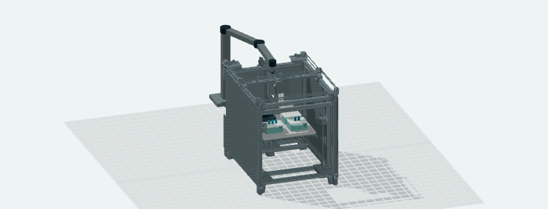
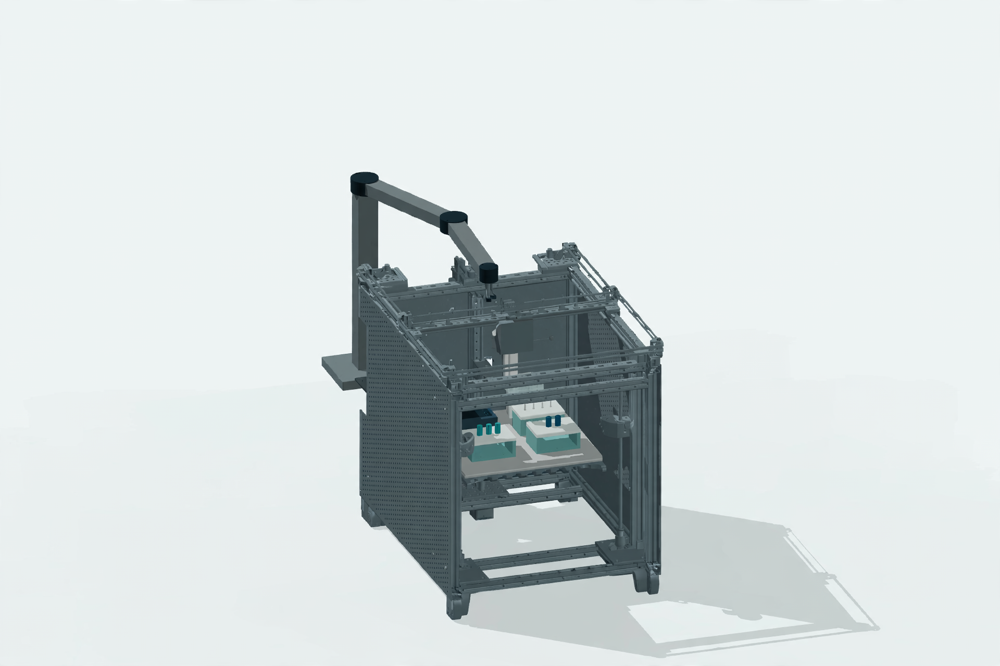

# Model choice, dictation and project illustration

These are implemented product paths using the configured Meta Model API account.
They complement the existing engineering conversation and separate photo-inspection
workflow. They do not add hardware control or replace the source CAD.

## Choose the conversation model

The selector above chat offers Muse Spark 1.3 Contributor, Muse Spark 1.3 Standard
and Muse Wonder 1.0. The backend checks the account's model catalogue and disables
unavailable choices with an explanation. Catalogue presence is advertised access,
not a successful-inference guarantee. A failed check can be retried explicitly.

Selection keeps the accepted project and conversation intact. Subsequent chat,
layout, extension and photo-analysis requests use the selected model, with its
actual reported usage recorded. Selection belongs to the running session; opening
a saved project uses the server's configured default again. Portable geometry and
file formats are unchanged.

Contributor is the default and may use content for Meta model training. Use
shareable or synthetic inputs. Standard models have separate API usage; the
interface explains the model's data policy and Wonder's greater cost. Account
credit and actual charges are not inferred from the catalogue.

## Dictate, review, then send

1. Select **Muse Voice**, allow microphone access, and speak for up to 60 seconds.
2. Select **Stop and transcribe**. The recording is sent to Muse Voice Transcribe.
3. Review the editable chat draft, especially numbers and units. Correct any
   transcription error, then select **Send** yourself.

Dictation never sends a chat message automatically. Cancel, denied permission,
silence and provider failures have explicit states. An overlong transcript remains
available to copy instead of silently truncating or replacing the existing draft.
Recording stops and microphone tracks are released on cancellation or navigation.

The browser records mono audio in memory and sends PCM16 WAV at 16 kHz. The server
also accepts 24 kHz, validates the complete WAV, strips metadata and caps duration,
size, concurrency and response time. Credentials stay server-side. The app does
not save raw recordings or log their text; separately collected synthetic test
evidence is identified in the verification record. Microphone capture requires
localhost or a browser-supported secure context.

English number words and spelled scientific units have a bounded deterministic
normalization path. It supports examples such as **five milligrams per milliliter**
and **two milliliters per tube**. Ambiguous totals, ranges, rates and missing units
still require clarification. This is a limited supported grammar, not universal
speech or scientific-language understanding.

## Create an optional presentation image

With an accepted design, open **Project details → Project illustration** and
select **Generate with Muse Image**. The app captures the actual current 3D view,
sends that reference once and displays the resulting image beside a comparison
with the original view. The result is downloadable as PNG and clearly labelled
**AI-generated illustration — not a technical drawing**.

Generation has a real waiting state, cancellation and a revision guard. It makes
no automatic retry, project edit or CAD export. Images are not inserted into the
portable project, engineering package or assembly instructions. Reopening or
changing the project clears a stale illustration. The backend accepts bounded
PNG/JPEG data only, strips metadata and disables provider web/image search and
shell tools for this request.

The observed results preserved the recognizable overall composition but changed
small mechanical details. They are useful presentation illustrations; source CAD,
the deterministic model and engineering instructions remain authoritative.

| Actual project reference | Actual Muse Image result |
| --- | --- |
|  |  |

This pair is from one recorded real request on confirmed revision 9. The original
Jubilee design is by Joshua Vasquez / Machine Agency, CC BY 4.0; see
[source attribution](../THIRD_PARTY_NOTICES.md). Image generation changes details.

## Usability changes

- A failed **New project** request retains the current work. A successful reset
  offers **Undo new project** for the previous in-memory workspace.
- Visible shortcuts reveal and focus the preparation plan or project files.
- The opening composer is reachable in the first mobile viewport; populated
  project controls wrap within the screen.
- Native keyboard controls rotate and zoom the 3D view. Source loading and
  failure are reported separately from the rendered scene.
- The hidden import input no longer creates an invisible extra keyboard stop.

These improvements were evaluated through agent walkthroughs and controlled
browser tests. They are not external-user interviews or a measured usability study.
See [delivery verification](verification.md) for actual live failures, corrections,
request counts and the distinction between live inference and offline fixtures.

## Provider references

Official documentation consulted on 2026-10-30:
[models](https://dev.meta.ai/docs/models),
[speech to text](https://dev.meta.ai/docs/speech-to-text),
[transcription endpoint](https://dev.meta.ai/docs/api-reference/voice/transcribe),
[image generation](https://dev.meta.ai/docs/image-generation),
[structured output](https://dev.meta.ai/docs/structured-output) and
[pricing](https://dev.meta.ai/docs/pricing-rate-limits).
Provider documentation describes capabilities; this account's bounded observations
are recorded separately and do not establish general model reliability.
