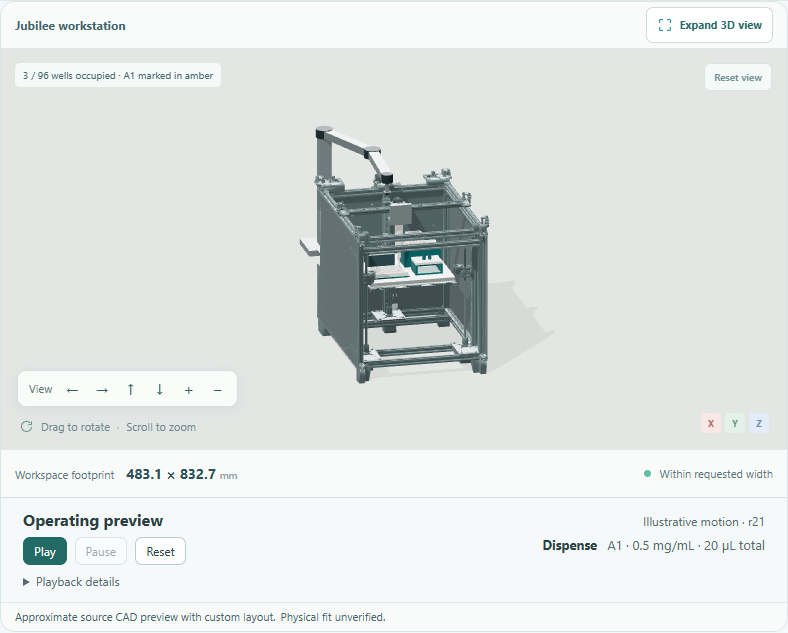

# See how the proposed setup moves

Operating previews connect the current design to an animated sequence. They help
review where the tool goes, which container it visits and how a different rack,
plate or recipe changes the proposed operation.

*Actual workspace capture at a planned transfer to A1. The displayed quantity is
a transfer total, not a measurement or a validated pipetting stroke.*

This is an adapter capability within MuseAutoLab's laboratory automation
platform. The initial preparation adapter covers the Jubilee setup with its
sample rack or supported 96-well plate. An accepted inspection concept has a
separate camera-sweep sequence. Unsupported platforms display a reason instead
of borrowing another machine's animation.

## Try it

The [saved plate and tip-rack example](examples/tip-rack-plate-project.json) can
be opened with **Open project** to inspect the preview without a model request.

1. Develop or open a supported design with a complete preparation plan. You can
   inspect a draft before confirming it; generating CAD files is not required.
2. Select **Play** in **Operating preview**. The status identifies the current
   action, destination and intended transfer volume.
3. Use **Pause** or **Reset**. Expand **Playback details** to scrub the sequence,
   choose a speed or switch to the inspection sequence when available.
4. Change the recipe, labware or tip-rack product. The preview stops and rebuilds
   against the accepted revision, including the selected holes and well addresses.
5. Download the motion plan from **Playback details** to inspect its revision,
   component/profile bindings, positions and illustrative timing.

Playback does not edit the project, update costs, request a model response or send
commands to hardware. It starts only on an explicit action. Hiding the browser
or switching away from the model on mobile pauses it without losing the position.

## What moves

The preparation sequence shows tip pickup, the stock or diluent source, the
assigned destination and tip disposal. Zero-volume transfers are skipped. For a
plate, destinations follow the occupied well addresses rather than an evenly
spaced approximation; a twelve-position tube rack uses its actual hole centers.
Changing the tip-rack profile changes its visited positions as well as its shape.

Jubilee's source-derived carriage and crossbar move horizontally. The source bed,
custom deck and its mounted containers move together vertically. The planner
checks the application's 0–150 mm bed-pose envelope and rejects a sequence that
exceeds it. That envelope is a model constraint, not a verified machine travel
specification. The canonical design and STEP export remain at their accepted pose.

Inspection playback follows the accepted pose sequence and maintains rigid link
lengths. It does not capture images or establish a calibrated field of view.

## Read the preview correctly

The displayed seconds are **preview time**, not a prediction of cycle time. Tool
approach offsets, disposable-tip representation and action durations are
illustrative. Containers must be open; cap handling and liquid dynamics are not
modeled. A transfer label shows the planned total, not measured dispensing.
Pipette capacity and splitting a transfer into repeated aspiration strokes are
not modeled; the sequence is not an executable liquid-handling protocol.

The source mesh is separated by existing assembly hierarchy for rendering, while
the pinned source STEP is unchanged. The [asset provenance](../app/assets/jubilee-c877bd2.motion-preview.json)
records the original revision, license, partitions, transforms and mesh hashes.
Flexible belts are omitted away from their
rest pose because rigid meshes cannot represent their deformation. Custom tool
attachments, motion clearance, loads, calibration and control still need
engineering verification. The viewer does not establish collision safety or a
successful physical simulation.

Downloaded motion plans explicitly set `execution_enabled` to `false`. They are
review artifacts, not G-code or protocols accepted by a robot controller. The
[software guide](software-and-protocols.md) describes the separate programming
and commissioning work.

## Implementation and verification

The frontend compiles a timeline from the accepted project and samples it using
one shared playback clock. The renderer applies rigid transforms without writing
them back to project geometry. Revision changes reset the preview; unavailable
adapters and invalid pose envelopes cannot be played.

See the [verification record](verification.md#revision-bound-operating-previews--2026-11-02)
for numerical and browser checks. Rebuilding the committed source preview meshes
is optional and memory-intensive (about 22 GB was observed during conversion).
Normal playback loads the prepared assets and does not import the source STEP.
