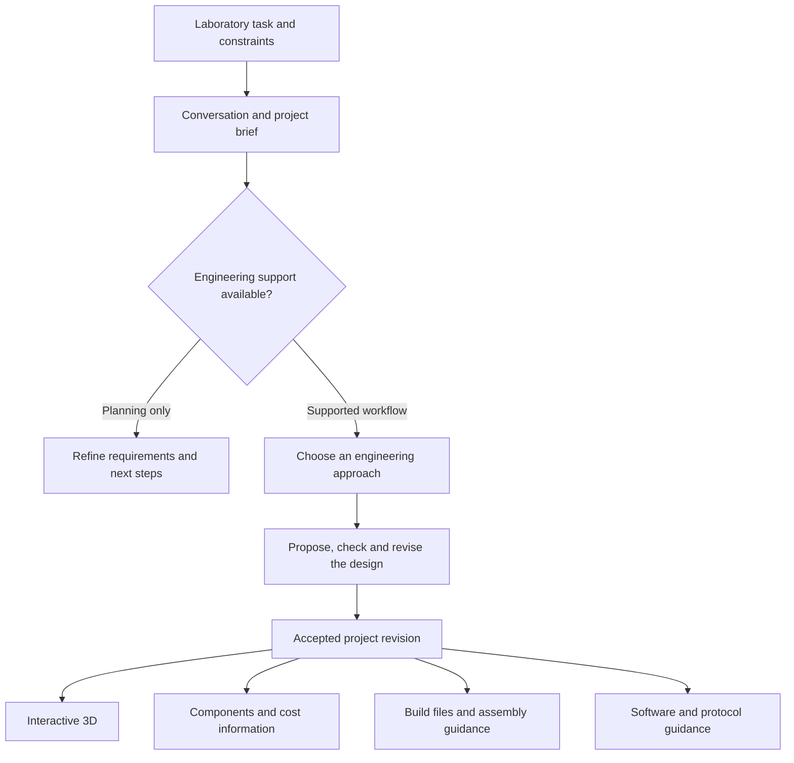

# A platform for custom laboratory automation

[Back to MuseAutoLab](../README.md) · [Documentation](README.md)

MuseAutoLab is being built to help researchers turn repetitive laboratory work
into automation setups designed around their own needs. The starting point is
the work: what needs to happen, what the lab already has, and what would make
the result useful. The machine follows from those requirements.

A setup may involve motion, sample handling, imaging, fixtures or several of
these together. That is the product direction. Each workflow needs its own
engineering support before MuseAutoLab can generate its design and build files.
Liquid handling is the first use case developed through that engineering path.

## From requirements to a setup

1. **Understand the work.** Describe the process, materials, equipment, space and
   constraints in ordinary language. Collect task-specific measurements when
   they become relevant.
2. **Choose an approach.** Discuss suitable equipment, existing open projects,
   custom modules and the tradeoffs between building and buying. A supported
   engineering route starts with an explicit choice.
3. **Develop the design.** Refine the setup in conversation. For supported
   modules, the accepted design connects the 3D view, component choices,
   cost information and assembly guidance.
4. **Prepare to use it.** Export the supported project files and consult the
   software and programming guidance for the selected equipment. Keep assembly,
   commissioning and experimental validation as distinct steps.
5. **Adapt it as the work changes.** Reopen a project, revise a supported module
   or plan another procedure using the same equipment.

## One project, specialized engineering

The application separates the general requirements conversation from engineering
logic for a particular workflow. A shared brief records the objective, process,
materials, available equipment and constraints. A workflow capability check
determines what can happen next.

Meta models handle discovery, explanation and supported design proposals.
Application code validates the structured updates, applies workflow-specific
checks and derives the supported outputs. Source identity and project revisions
connect those outputs. A rejected design update preserves the accepted project.

This separation allows a new workflow to have its own requirements, geometry and
checks while retaining the common project experience. Adding engineering support
still requires implementation: a new prompt alone does not add a machine family.

## Current implementation

| Layer | Available now |
| --- | --- |
| Requirements and planning | A general brief can generate a revision-specific functional plan with ordered operations, equipment roles, handoffs, acceptance checks and open questions. The specification is downloadable as JSON. |
| Engineering | Liquid-preparation designs using Jubilee source CAD with custom modules or a schematic Opentrons OT-2 configuration; a separate bounded non-liquid bench-station adapter. |
| Components and cost | Supported US catalog retrieval, source references, selected alternatives and separately labelled planning estimates. Coverage depends on the supported component catalog. |
| Project continuity | Revisioned designs, portable save/reopen, supported design changes and revision-specific exports. |
| Software guidance | Equipment-specific setup and protocol-authoring guidance, a standalone logical direct-dilution preview, and a downloadable operator-assisted bench-station record runner with optional printable HTML label output. |

The [liquid-handling example](use-cases/liquid-handling.md) shows the engineering
layer in detail: a workstation adapted to tubes or a microplate, component
choices, pricing and instructions. Its test records establish that specific
coverage. The [non-liquid bench station](bench-station.md) adds another specific
path: ordered weighing, printing, barcode reading and visual inspection modules,
conceptual access envelopes, sourcing references and a local human-checkpoint
runner. It generates no vendor CAD, automated transport or instrument control.
Other task families can be discussed and planned; their engineering adapters
still need implementation.

Current designs are digital proposals. Neither supported platform has a hardware
control or physics adapter. Physical fit, mounting, calibration and laboratory
performance require separate work. See the [verification record](verification.md)
for the checks actually performed.

## Extending the platform

A new engineering workflow should define its required inputs, supported hardware
and source references, design representation, checks and available outputs.
Its viewer, component information, instructions and exports should describe the
same accepted revision. Unsupported operations should remain visible in planning
instead of being represented as completed engineering.

Useful starting points in the code:

- [Workflow registry and generic brief](../app/workflows.py).
- [Model instructions and structured proposals](../app/model_client.py).
- [Source and adapter policy](source-grounding.md).
- [Development and verification commands](development.md).

This is the extension approach for the codebase; there is no automatic plugin
installer or arbitrary-machine generator in the current release.
