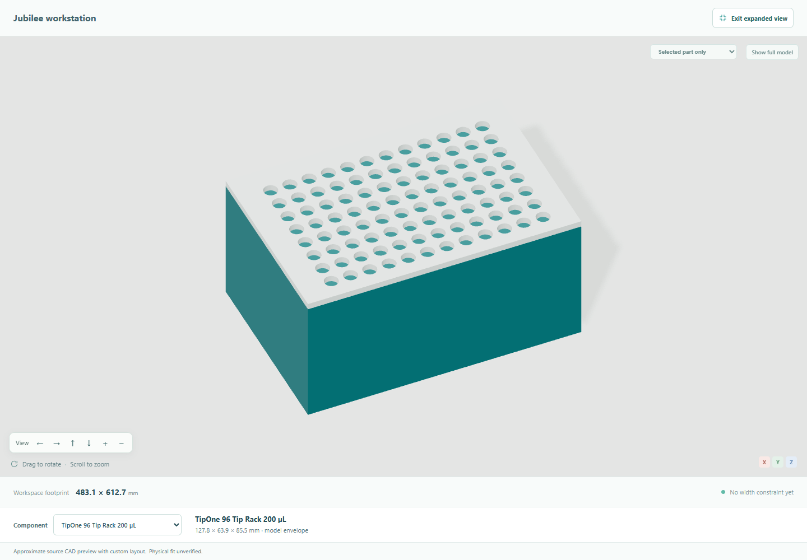
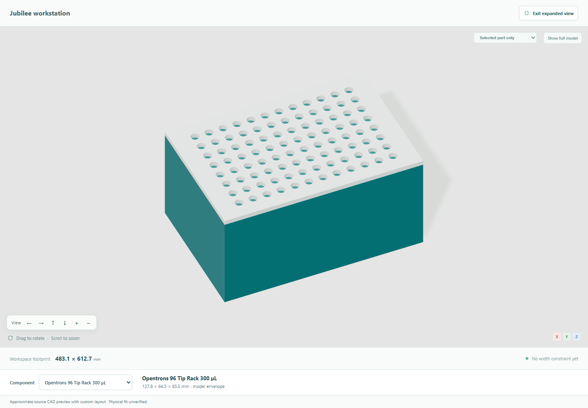

# Presentation flow: tubes, plate, suppliers and instructions

Checked on 2026-10-31 with the actual browser, application, Muse Spark Contributor
and public supplier retrieval. Laboratory inputs are synthetic; the replies and
resulting application states were real. This is digital integration evidence,
not a physical demonstration or an independent user study.

Open the [saved final project](examples/presentation-flow-project.json) through
**Open project**, or follow the natural English requests in the
[hands-on guide](demo-guide.md#rehearse-the-main-journey).
The [downloaded instruction guide](examples/presentation-flow-instructions.html)
records the tested revision and dated price context. Reopening creates a new
runtime project and requests fresh planning estimates; old supplier observations
are not silently relabelled as newly checked prices.

## What was exercised

| Step | Observed result |
| --- | --- |
| Start with a laboratory problem | Compared assembled OT-2 and open-hardware Jubilee, then waited for explicit Jubilee choice. |
| Set preparation values | 5 mg/mL stock; 0.5, 0.25 and 0.05 mg/mL targets; 200 µL per preparation. Stock/diluent pairs are 20/180, 10/190 and 2/198 µL. |
| Create a tube rack | Declared body/rim/cap/below-rim dimensions 12/15/18/40 mm, 12 positions and 4 columns produce the proposed 81.5 × 43 × 56.7 mm rack. These are test inputs, not measured Eppendorf product dimensions. |
| Switch to a 96-well plate | One message selects the named Corning software reference and custom holder. A1, B1 and C1 are occupied; there are still three preparations. Recipe arithmetic and other components are preserved. |
| Change supplier product | TipOne and Opentrons compile different opening patterns and diameters. The proposed 0.24 mm rack movement is displayed before selection. The second choice preserves the accepted position and the rest of the design. |
| Retrieve prices | Real supplier retrieval yields a partial verified subtotal, with missing supplier prices covered separately by model estimates. |
| Generate instructions | Revision 12, the selected Opentrons profile, plate, well assignments, price report and instruction downloads agree. |
| Save and reopen | Rebuilt plate, tip rack and preparation remain identical. |

Actual focused views from the supplier comparison:

The reference openings and schematic recesses are based on pinned software
definitions, not manufacturer CAD or measured pipette compatibility.

## Failure found and corrected

The first run stopped at the tube-rack request with a source-validation error;
the project was unchanged. An offline check reproduced a narrow language bug:
`length below the rim 40 mm` was not recognized as an axial measurement.

The correction accepts natural length/height/distance wording below, under or
beneath the rim, while retaining literal value/unit binding. Tests continue to
reject volume units, swapped measurements, ambiguous alternatives and confusing
axial length with rim diameter. The original prompt then passed through the real
model. Replaying that actual diagnostic response against the old validator fails
and against the corrected validator passes. The original failed raw response was
not retained, so the exact cause of that earlier model response is not proven.

The evidence comprises the initial fresh run, a continuation restored from its
unchanged preparation state, and the supplier/resources browser phase. It is not
claimed as one uninterrupted clean run. Failed evidence was retained, and there
were no automatic chat retries.

## Price scope and checks

During the final catalog check, **3 of 12 purchase groups** had fresh supplier
prices, totaling **USD 246.98**. The other nine groups had labelled model ranges
of **USD 1,475–4,170**, giving a combined planning range of
**USD 1,721.98–4,416.98** for the covered scenario. Three supplier responses were
HTTP 429; they remained unverified rather than becoming invented quotes.
Unknown stock, compatibility, engineering, assembly, tax and shipping are not
established by these figures. This is not a complete machine quotation.

The final checks passed 99 grounding/API tests, four focused geometry checks,
22 independent output-consistency assertions, Ruff and production build/typecheck.
Browser captures recorded no page errors. JSON, HTML and Markdown instructions
and CSV/JSON procurement downloads were checked; HTML was viewed on desktop and
mobile. The existing bundle-size advisory remains. Full heavy CAD regeneration
and physical operation were not performed for this language-parser correction.

Reported provider consumption was **206,063 observed tokens**, including the
failed request and the final reopened workspace's estimate. One automatic
estimate was cancelled/incomplete at browser shutdown with unknown consumption;
the observed count is therefore not a complete billing total. New estimates can
differ between requests. See the [verification record](examples/presentation-flow-verification.json)
for the retained scope, attempts, checks and artifact hashes.
