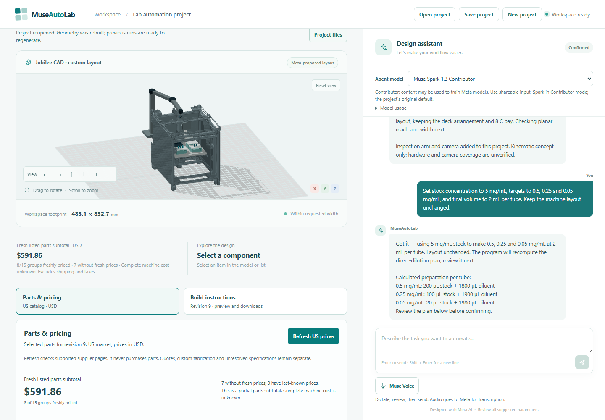
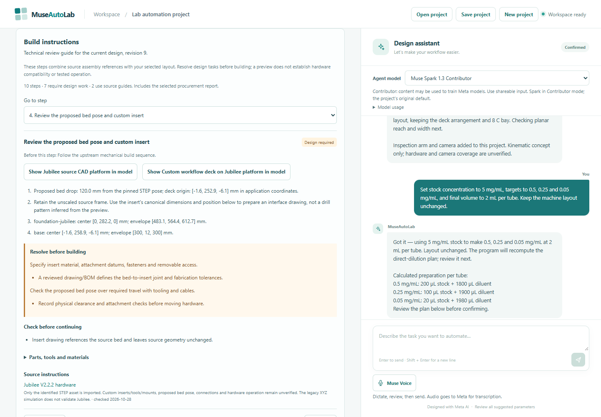

# US pricing and project instructions

MuseAutoLab keeps an accepted design, supplier observations and build guidance
connected to the same project revision. Pricing is a read-only check of reviewed
public US supplier listings, in USD. It does not order parts.

Recorded project reopened in the real app on 2026-10-30. The capture uses actual
supplier observations: eight of fifteen groups priced, USD 591.86 partial subtotal.
These are dated observations, not guaranteed current prices or a complete quotation.

## Use the product

1. Develop or reopen a supported design. Open **Parts & pricing** below the model.
2. Choose **Refresh US prices**. The app retrieves supported supplier listings,
   verifies their product identity and shows quantity, pack, availability, source
   and observation time. Opening the panel alone does not contact suppliers.
3. Review the partial subtotal and each missing price. Jubilee's original platform
   expands into a reviewed set of non-overlapping candidate kits plus an explicit
   unpriced remainder. Kit contents are not added a second time as loose parts.
4. Open **Build instructions**, or ask in chat how to source and assemble the design.
   Step navigation highlights the relevant component in the model. The guide uses
   the accepted dimensions, positions, selected variants and official references.
5. Download the pricing CSV/JSON and instruction HTML/Markdown/JSON immediately.
   These documents do not require a model call or a heavy CAD export. A full
   confirmed-project package includes the same guide and its bound price report.

## What the numbers mean

The subtotal includes freshly observed, available listed items only. Unknown parts
are not assigned zero cost. The interface separates expired last-known prices and
dated original catalog references from fresh offers. A short 15-minute cache avoids
repeated supplier requests; its original observation timestamps remain visible.
An open tab rechecks the saved report at expiry or when returning to the window,
without automatically querying suppliers. Use **Refresh US prices** for a new
supplier check.

The US market setting specifies source listings and currency. It does not determine
shipping eligibility, destination-specific sales tax, duties or lead time. Those
costs, custom fabrication, assembly, validation and unspecified hardware are excluded.
Coverage counts procurement groups, not every physical part or the percentage of
the complete machine's cost.

Jubilee candidates trace back to the [official BOM navigation](https://jubilee3d.github.io/machines/jubilee_2/bom.html)
and its linked V2.2.2 shopping list. The list is living source material: old prices
are not used as live prices. For example, the current motor kit contains documented
supplier replacements, and a matched left/right mount set is one purchase unit.
Candidate offers retain compatibility notes; they do not change the canonical CAD.
The assembled OT-2 route remains a configuration and quotation checklist, with no
legacy Jubilee motor/frame BOM or fabricated price.

## How instructions are generated

The instruction builder compiles a structured guide from the canonical project,
source bindings and optional current procurement report. It records prerequisites,
part IDs, selected variants, placement, source links, checks and specific engineering
tasks with completion criteria. Original Jubilee assembly uses upstream booklets;
OT-2 setup uses manufacturer installation and calibration instructions. Cooling and
inspection steps appear only when their accepted components exist.

The current guide is a technical review and setup aid. Custom mounting, actuation,
loads, tolerances and hardware validation still require engineering work. **Review
step**, **Follow source guide** and **Design required** distinguish these scopes.
No invented fasteners, tightening values or calibrated operating instructions are
inferred from a schematic. Muse Image is separate presentation artwork and does not
author the technical geometry or this guide.

## Continuity and implementation

Reports belong to a runtime project ID and revision, with a separate report ID.
Changing the design invalidates the prior report. Reopening a portable project
rebuilds its geometry under a new runtime ID and requires a new price check. This
prevents old prices from appearing to be newly verified. Reports are process-local;
download them before restarting the server if an observation must be retained.

Only server-owned supplier URLs are fetched. The adapters bound time, response size
and concurrency, reject unexpected redirects and validate exact product identity,
USD currency, variants and pack quantities. Failed or ambiguous pages stay unknown;
there is no unrestricted web crawling or model-generated supplier URL. See
[verification](verification.md) for the actual software, supplier and browser checks.
