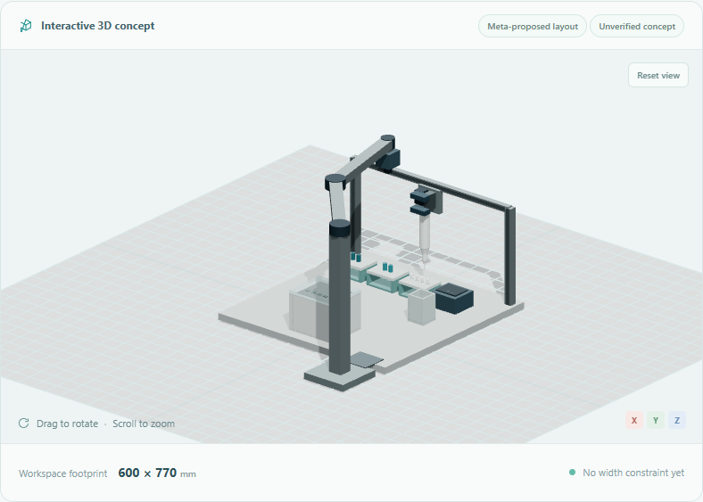

# Save, reopen and expand a workstation

MuseAutoLab keeps a project useful beyond its first model. Save a workstation,
reopen its accepted design, then ask Meta to add an inspection capability while
preserving the original machine components.



The view reopens a synthetic cooled workstation and the recorded real Meta
extension proposal described below. Rendering it made no additional model call.

## Walkthrough

1. Start with the general laboratory problem, such as time spent preparing aliquots
   and dilutions by hand. Discuss equipment and choose quantities later with Meta.
2. Use **Develop design with Meta**. The checked proposal appears after the design
   progress indicator completes.
3. Request smaller-space or cooling revisions and develop a fresh accepted layout.
4. Choose **Save project**. Use **Open project** to reopen that file, including after
   restarting the backend. Refresh also resumes the latest project on this browser.
5. In **Expand this workstation**, describe the inspection request and choose
   **Add arm and camera with Meta**. The accepted extension creates a draft revision;
   the original workstation geometry and component IDs are preserved.
6. Inspect the new parts, use **Preview inspection sweep** or its slider, and review
   the recorded model, rationale and checks. **Labware photo check** separately
   analyzes an actual uploaded/captured image through Meta with human review.
7. Confirm the ready preparation design and generate project files. An extended
   package includes 24 files, adding `inspection-module.json` and
   `inspection-poses.csv` to the base 22-file package.

## What Meta chooses

The runtime model proposes two link lengths (180–500 mm each), mast height
(400–550 mm), rationale and assumptions. Application code supplies the two-link
horizontal-arm architecture, front-right sidecar location, downward camera and
inverse kinematics. The sidecar extends depth beyond the existing deck, including
a cold bay when present. The existing workstation is never scaled or moved by
this action.

Schema validation, planar reach at four recorded target poses and their overall
width envelopes gate acceptance. One diagnostic correction is allowed, with a
45-second per-attempt and 90-second loop bound. A rejected/failing run preserves
the prior project. No model-generated executable code is run.

The sweep reconstructs joints and fixed-length links between keyframes for display.
It is a kinematic illustration; continuous swept clearance, collisions, loads,
hardware selection, fasteners, control, calibration and camera coverage remain
unverified. Three added hardware groups remain explicitly unpriced. MuJoCo results
declare `scope: liquid_preparation_only` and
`inspection_extension_excluded: true` for extended projects. A successful pipette
simulation is not a successful arm simulation.

Requirement/configuration edits and a fresh workstation-layout proposal clear the
old extension; design it again for the changed geometry. Removing the module keeps
the accepted workstation, increments revision and invalidates confirmation/files.

## Portable state

The JSON format is `museautolab-project`, schema 1, compiler 1, with a 256 KB cap.
It stores canonical brief/workflow/summary inputs, selected catalogue variants,
accepted layout/extension proposals and historical provenance, logical project ID,
revision/status and the last eight server conversation entries. It contains no
API key, arbitrary CAD code, photographs, simulation results or running job IDs.

Opening validates fields, rejects unknown versions/extra fields, duplicate JSON
keys and non-finite values, and rebuilds derived data using the current compiler
and geometry checks. Each opening receives a new runtime ID and preserves
`lineage_id`, preventing an older runtime's jobs from attaching to a reopened
project. Saved provenance is historical metadata supplied by the file; reopening
does not authenticate its claimed model or call Meta again. The new geometry
checks are computed locally. Outputs and photo reviews must be regenerated.

The last snapshot is also stored in local browser storage. **New project** clears
that remembered slot; download a file to keep multiple projects. Browser storage
is local convenience, not cloud synchronization or a backup service. If a stored
file is incompatible, Open project or New project remains available.

## Implementation and evidence

| Responsibility | Source |
| --- | --- |
| Snapshot validation and rebuild | `app/project_storage.py` |
| Bounded runtime Meta extension loop | `app/inspection.py` |
| Fixed architecture, inverse kinematics and shared primitives | `app/inspection_geometry.py` |
| Same-revision viewer and CAD | `web/src/Scene.tsx`, `app/cad_exports.py` |
| Extension documents and assembly review | `app/assembly.py` |
| Workstation-only physics scope | `app/physics.py` |

On 2026-10-28 one real Contributor request over a synthetic cooled workstation
fixture proposed 320 + 320 mm links and a 450 mm mast. It passed on its first
attempt; reported usage was 856 input / 575 output tokens, with 7.203 seconds for
the design operation in that run. Reopening reproduced its exact geometry; CAD
export contained 20 components and the nominal **workstation-only** MuJoCo result
passed. The base layout was a synthetic fixture; this check does not establish a
live end-to-end machine-design benchmark. The [curated response](examples/inspection-extension-live.json)
retains the actual proposal, checks and usage, without credentials or private records.

Run the meaningful offline checks in the locked environment:

```powershell
.venv/Scripts/python.exe -m pytest tests/test_project_storage.py tests/test_inspection.py tests/test_inspection_geometry.py tests/test_inspection_cad.py tests/test_inspection_physics.py -q
.venv/Scripts/python.exe tests/browser_evolution.py
```

The browser test uses explicit offline model fixtures but the real API, persistence,
geometry compiler, CAD, MuJoCo and archive generation. It exercises file opening,
refresh/resume, extension, visible sweep, extended-package hashes/revisions,
removal/stale outputs and invalid-file recovery. It makes no provider or webcam
request. The original four browser suites remain regression checks. None of these
digital tests demonstrates built hardware or laboratory performance.
