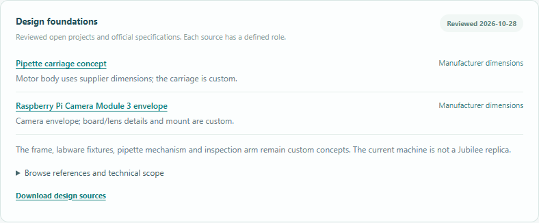

# Reviewed sources for models and recommendations

MuseAutoLab now supplies Meta with a curated library of primary references and
binds sourced dimensions to the actual geometry. Each record identifies its
publisher, consulted date, supported facts, permitted interpretation and limits.
Open projects also have an immutable repository revision and a license source.



The screenshot uses a synthetic offline browser fixture. The references and
manufacturer dimensions are the same reviewed data used in the real application.

## Current library

| Reference | Role in this version |
| --- | --- |
| [Jubilee hardware](https://github.com/machineagency/jubilee/tree/c877bd2e889560c83da2a68479641a4f7f0d9b83), CC BY 4.0 | Actual pinned STEP foundation for new chat-developed workstations; fixed source parts remain unscaled |
| [Science Jubilee](https://github.com/machineagency/science-jubilee/tree/bb918fa78f300f57cc379a80731cfca7bdb55c66), repository MIT | Documented pipette/camera workflow and integration reference; upstream hardware rights remain separate |
| [Pololu 1209](https://www.pololu.com/product/1209/specs) | Published 35 × 35 × 36 mm motor-body dimensions, excluding shaft |
| [Pololu 1208](https://www.pololu.com/product/1208/specs) | Published alternative body dimensions, 35 × 35 × 28 mm |
| [Raspberry Pi Camera Module 3](https://www.raspberrypi.com/products/camera-module-3/) | Standard-lens 25 × 24 × 11.5 mm overall camera envelope |
| [Opentrons Temperature Module](https://docs.opentrons.com/temperature-module/product-specs/) | Existing 194 × 90 × 84 mm commercial-module envelope; thermal block/sample behavior is separate |
| [Opentrons OT-2](https://opentrons.com/products/ot-2-robot) | Assembled-platform alternative: published 630 × 570 × 660 mm enclosure, official deck-slot software data; schematic proxies, no manufacturer machine CAD |

Reviewed on 2026-10-28. These are published nominal dimensions, not measurements
of purchased hardware. The library is a dated snapshot, not a live supplier
search. Existing price observations retain their separate 2026-10-27 date;
new camera/arm hardware remains unpriced.

The OT-2 entry was reviewed on 2026-10-29. Its software deck grid is pinned at
`95a8a37922cfd5f46ad26c983bcc1659fa13b6e1` under Apache-2.0, with license and raw
hash in `app/data/ot2/`. The [installation specifications](https://docs.opentrons.com/ot-2/system-description/specs/)
require 200 mm ventilation clearance around the instrument; width checking uses
1030 mm including both sides. Other access/installation needs remain unchecked.
Compatible instrument pipettes, labware, exact capacity and calibration must be
confirmed. Prices, stock and delivery need an official configuration/quote.

Ordinary chat first collects needs and compares curated alternatives. Only an
explicit platform choice enables its design adapter. Meta supplies contextual
reasons/tradeoffs and bounded proposals; the application provides allowlisted
source facts and performs checks. Purchase/assembly guidance follows the chosen
route and links official BOM/configuration/setup material. This is a bounded
catalogue, not a live search or general robotics design guarantee.

## Actual geometry versus references

In legacy custom-frame projects, selecting either Pololu motor changes the internal primitive in the
shared viewer/CAD geometry to that variant's documented body size. The enclosing
carriage remains a custom concept, and shaft/mount/transmission clearances remain
unverified. The inspection camera uses the manufacturer's overall envelope; its
board/lens drawing is schematic. Its custom neck is a separate component.
Purchased-body dimensions are not scaled to fit a requested layout.

The open-hardware route imports the actual [Jubilee STEP asset](jubilee-cad-asset.md), with its
original hash, revision, attribution and license. The frame and fixed native parts
remain unchanged. Only the original build-plate subassembly's proposed vertical
pose changes. Custom inserts, pipette adapters, racks, waste and articulated arm
remain concept geometry. Source geometry is not a tested liquid handler; travel,
connections, mounting and source/custom collisions are unverified. Science Jubilee
software is an integration reference and is not installed. The viewer uses
approximate source-derived meshes; the original STEP is the CAD authority.

The assembled OT-2 route instead has a manufacturer envelope proxy and documented
slot assignments. Internal geometry, rack bodies and pipette mount remain custom
schematics, labeled separately in the source bindings. Its BOM is a quote checklist,
not the Jubilee motor/frame list. No custom inspection/cooling adapter or physical
simulation is implemented for OT-2; failed requests preserve the previous project.

## Runtime advice and evidence

Meta receives the reviewed library in chat, layout design and inspection expansion.
Chat recommendations have a bounded typed `reference_id` plus a reason. Unknown
IDs are rejected; the server resolves the official title, link, revision and scope
from its own library. The model cannot supply a replacement URL or license in that
record. Recommendations do not become user requirements. Explanations remain model
output and still need engineering review; source linkage is not proof of every
free-text inference or hardware compatibility.

Recent conversation preserves the cited IDs, and reopening restores clickable
reference links. **Download design sources** provides revision-gated machine-readable
bindings. The same `design_basis` travels with `project.json`, the CAD geometry
report and the assembly guide; accepted design provenance records the library hash.
Source-only references and custom geometry remain distinguishable in exports.

Portable files use compiler version 3, with an allowlisted foundation ID and bed
pose. Version 1/2 inputs and conversation reopen, but their incompatible prior
design/extension is cleared, creating a draft that asks for a new design in chat.
Unknown compiler versions remain rejected. Old jobs/results are not restored.

Before the source-CAD integration on 2026-10-28, one real Meta advice request recommended the two pinned open projects
without inventing opening concentrations/volumes. A separate real layout request
accepted on its first attempt and exported the documented motor geometry and the
same source manifest to CAD. The [curated live example](examples/source-grounding-live.json)
records the actual outputs/usage over shareable synthetic inputs. Two calls reported
7,706 input and 1,686 output tokens; no billing/accuracy claim is inferred.

## Verification and maintenance

```powershell
.venv/Scripts/python.exe -m pytest tests/test_design_sources.py tests/test_sourced_geometry.py -q
.venv/Scripts/python.exe tests/browser_foundation.py
```

The browser fixture stubs Meta only; actual source resolution, API, geometry,
selection, source-file download, saving and reopening run locally. Existing CAD,
physics, photo and project-evolution suites remain regression checks.

To add a reference, consult its primary documentation, record exact supported
fields and unresolved interfaces, pin open-project revisions and review the
applicable license. Update the data, bindings and model allowlist together.
Geometry-changing updates require a compiler-version/migration decision. Do not
infer reuse rights from a public repository alone or copy vendor CAD without
checking its terms. A reviewed catalogue page does not establish supplier
availability, performance in this workstation or laboratory validation.
