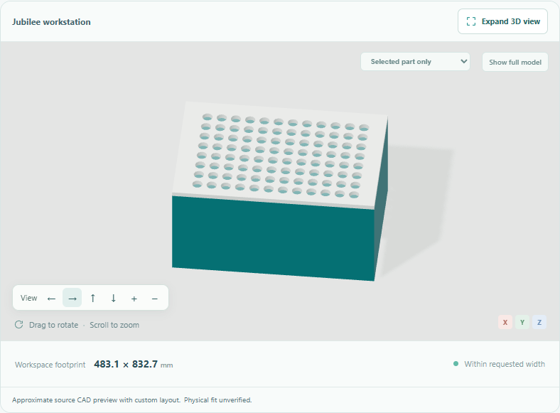
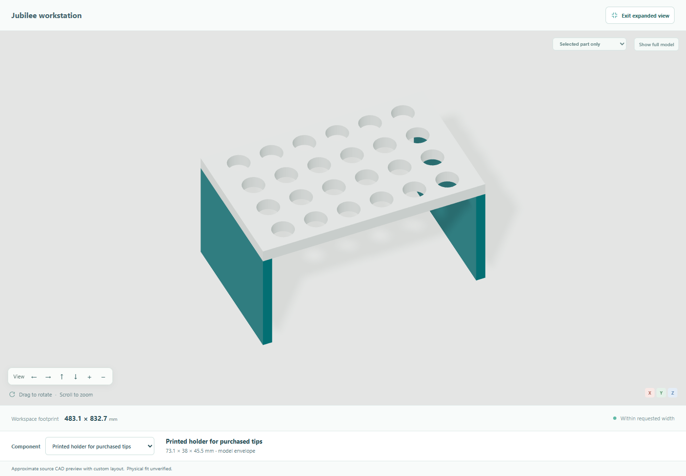

# Supplier-dependent tip racks and a printable holder

On an accepted Jubilee workstation, ask **“Compare tip racks from different
suppliers.”** The conversation shows two reviewed product references and asks
whether you have access to a 3D printer. Select a product with **Use this rack** or name
it in chat. The selected rack changes in the 3D model, parts list, source record,
build guide and saved project. This is a bounded product adapter, not automatic
geometry generation for every supplier catalog.

| Reference | Envelope, length × depth × height (mm) | Opening diameter | Positions |
| --- | --- | --- | --- |
| USA Scientific / TipOne 96 Tip Rack 200 µL | 127.76 × 85.48 × 63.90 | 6.40 mm | 96 |
| Opentrons 96 Tip Rack 300 µL | 127.76 × 85.48 × 64.49 | 5.23 mm | 96 |

These products have similar outer dimensions. Their opening sizes and locations
really differ; the viewer does not exaggerate their shapes to make the comparison
more dramatic. Select **Tip rack**, open the expanded view and use **Selected part
only** to inspect the change. The source-bound racks show no invented tip models.
Choosing a different retailer for the same product does not justify different CAD.

The definitions come from the pinned Opentrons software library. They are not
manufacturer CAD: the shallow visual recess, colors and simplified body are
illustrative. Source details and limits are available in the component cards and
[third-party notices](../THIRD_PARTY_NOTICES.md). Prices, current stock, exact pack
and pipette compatibility remain unverified. Supplier family-page starting prices
are not assigned to one modeled rack.

## Placement and revisions

The application preserves preparation quantities, source machine and other
components. It checks the rack's footprint against the current insert and known
neighbor envelopes. If a translation is needed, the alternative card shows its
distance and X/Z offsets before **Use this rack** accepts that draft placement. A direct
chat choice without a previously shown proposal asks for movement confirmation.
An incompatible fixed-position request is rejected. These envelope checks do not
establish robot clearance, fixation or successful tip pickup.

Successful choices create a new draft revision and invalidate old generated files.
Failed choices retain the accepted design. Save/Open preserves the selected profile,
dimensions, source binding and declared printer capability and rebuilds the model.
Other platform routes currently have no tip-rack placement adapter.

## Printing a holder for purchased tips

With printer access unknown, the agent asks first. With an explicit **no**, it
keeps the commercial choices. With **yes**, it can offer a custom holder and asks
for the dimensions needed to support the purchased tips:

- Maximum body diameter that must pass through the opening.
- Minimum and maximum supporting rim diameter.
- Length below the underside of the rim.
- Number of positions and columns; optional pitch and radial clearance.

Nominal tip volume does not supply these measurements. Missing or contradictory
dimensions cannot become accepted geometry. Capacities are bounded to 1–96
positions and 1–12 columns, subject to actual footprint and support checks.

For a **synthetic demonstration only**, after confirming printer access:

> Design a printed holder for purchased tips. Maximum body diameter 6 mm,
> minimum rim diameter 9 mm, maximum rim diameter 10 mm, length below the rim
> 35 mm, 24 positions, 6 columns.

The example is not a specification for an actual commercial tip. The holder is an
open bridge with a perforated top and two continuous legs. The guide records fit
assumptions and first-article checks. After project confirmation, the CAD package
contains `tip-rack.step`, `tip-rack.stl` and matching fit-coupon STEP/STL files in
`cad/`, generated from the same canonical dimensions. Commercial references remain
reference geometry in the assembly, not standalone fabrication files.

Print and measure the small coupon before attempting a holder. Printer accuracy,
material, cleaning, contamination control, stability, attachment and pipette
coupling require physical assessment. No printable disposable tip or validated
liquid-handling capability is claimed. A printer declaration is not a printing
service request or permission to buy anything.

## Verification

Saved examples can be reopened through **Open project** without a Meta key:
[TipOne](examples/tip-rack-tipone-project.json),
[Opentrons](examples/tip-rack-opentrons-project.json), and the
[24-position printed holder](examples/tip-rack-printed-project.json).
The [plate plus Opentrons rack example](examples/tip-rack-plate-project.json)
comes from the additional real Italian browser check and retains unknown printer
availability for the next user to answer.
They are draft review states from synthetic tests. TipOne and the holder were
selected through real Meta chat; the Opentrons chat requested placement approval,
then an explicit deterministic choice accepted it. The
[printed-holder guide](examples/tip-rack-printed-guide.html) is also directly
readable, with a [Markdown version](examples/tip-rack-printed-guide.md).

See [delivery verification](verification.md) for actual run results, retained
failures and limits. The offline browser check exercises the normal demo layout,
both commercial choices, visible placement, rollback, printer gating, declared
dimensions, revision-specific instructions, Save/Open and mobile layout:

```powershell
.venv/Scripts/python.exe tests/browser_tip_options.py
```

The browser's model extraction is a deterministic fixture; it is not live Meta
evidence. The separate bounded real-model evaluation records each provider call
and its usage. CAD tests reopen actual solids and check openings and support
material. These developer checks do not substitute for independent user research
or physical validation.

## Actual product views

The two source references use the same framing. The printed example uses the
synthetic 24-position dimensions above. Finishes are illustrative.

| TipOne reference | Opentrons reference |
| --- | --- |
|  |  |


