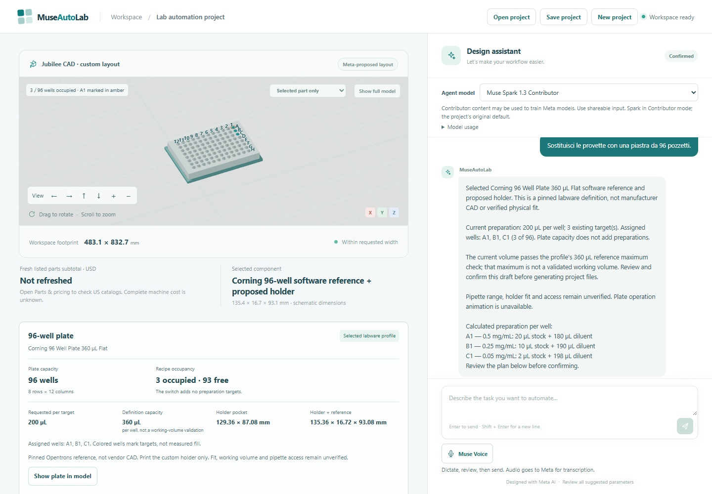
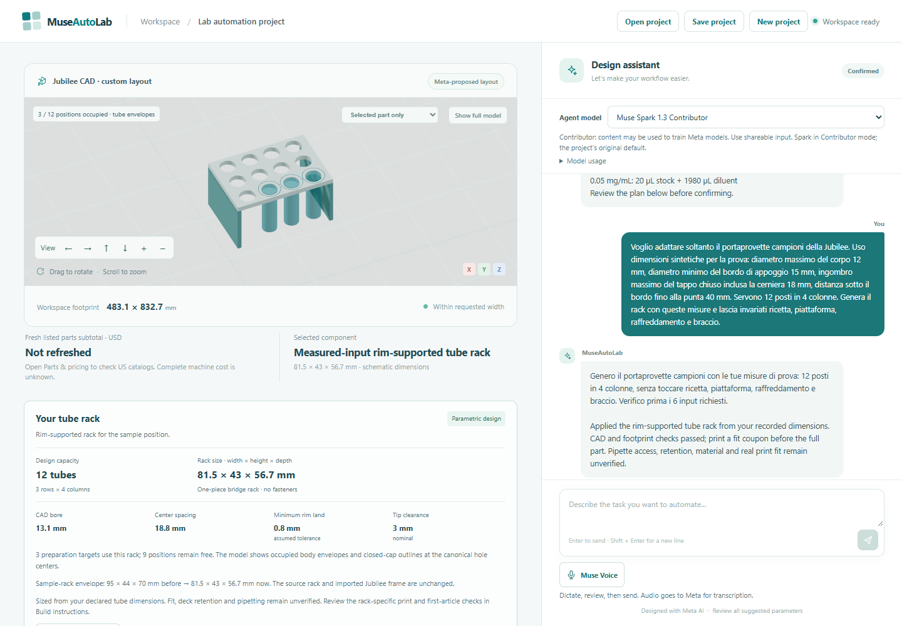

# Delivery verification

## Revision-bound operating previews — 2026-11-02

The [operating preview](operating-previews.md) animates the current Jubilee
preparation and inspection sequences. The full regular suite passed **1,065 tests**
in 178.75 seconds, including 22 tests that execute the actual TypeScript motion
compiler against canonical projects. TypeScript, production build and Ruff passed.
The existing large-JavaScript-bundle warning remains. The final Impeccable scan
reported no findings across the five changed UI targets; it was a scoped scan,
not a replacement for the earlier whole-workspace audit.

Compiled browser checks passed tube, plate and supplier revisions, play/pause,
seek, speed, completion, inspection, expanded keyboard controls, mobile tab
switching, Save/Open and unchanged project snapshots. The existing custom-rack
browser regression also passed. Follow-up checks on the final build verified
source/sample approaches and inspection playback when a preparation is unavailable.
The compact model is fully framed at 1440 × 900; the complete cost block ends at
852 px in the synthetic test. Catalog/model requests were blocked in these browser
tests, so this result does not revalidate prices or live-model behavior.

The source partition check retained 1,785,242 raw triangles and identical bounds;
aggregate surface area and signed volume agree within the recorded tolerances.
The [asset manifest](../app/assets/jubilee-c877bd2.motion-preview.json) records the
source, transforms, approximation and checks. The original STEP remains unchanged.
The heavy CAD export suite was excluded from this run; a new full CAD package was
not generated for this renderer-only change.

A separate 10-second observation on the final build recorded median browser
animation-frame intervals of 8.3 ms and p95 of 8.8 ms, with no interval over
50 ms or page error. This measures scheduling on the test computer while the
scene moves, not rendered GPU frames or physical-device performance. Browser
screenshots and numerical checks do not validate collisions, dispensing,
calibration or machine operation. No new Meta response was required for these
deterministic checks or playback.

## Revision consistency and workspace review — 2026-11-02

The [latest consistency review](revision-consistency.md) follows the real
liquid-handling journey through tube/plate changes, two supplier products,
US prices, another recipe, inspection, instructions and Save/Open. It records
the corrected price-continuity and unchanged-constraint defects, the 1,043-test
regression pass, full CAD export and remaining depth-fit limitation. The separate
[workspace review](workspace-quality-review.md) covers actual UI and 3D checks.

Earlier results below retain their original scope and dates.

## Reusable protocols and conversation feedback

The [software and protocol guide](software-and-protocols.md) adds route-specific
programming guidance, a revision-bound recipe template and a standalone logical
preview. Safe Markdown fixes literal emphasis markers in assistant replies.
The model area now shows request/update feedback without remounting its canvas;
recipe-only or pricing changes do not claim a geometry update.

The final targeted regression run passed **48 tests** across software guidance,
preview validation, whole-API preservation, instructions, procurement downloads
and conversational foundation updates. Browser checks separately passed Markdown
rendering and unsafe-content rejection, desktop/mobile layout, reduced motion,
failure/reset cleanup, supplier selection and unchanged canvas identity. Build,
typecheck and Ruff passed. The final Impeccable source scan retained the same six
context-reviewed findings, with no new finding.

Two actual Muse Spark Contributor API calls passed through the isolated real
application: a software question preserved the entire current recipe and design;
a second recipe preserved hardware and suppliers while changing A1/B1/C1 to
30/6/3 µL stock plus 120/144/147 µL diluent. Observed request times were 10.750 s
and 9.219 s, with **54,933 total reported tokens**. There were no automatic model
retries. These were API checks; the browser checks used explicit synthetic model
responses. The [curated record](examples/software-protocol-verification.json)
and [reopenable project](examples/software-protocol-project.json) preserve that
distinction. Downloaded preview execution passed without hardware connections.

This demonstrates another supported recipe on the same proposed workstation.
It does not implement arbitrary pipetting workflows, an upstream robot-control
adapter, physical calibration or measured laboratory performance.

## Full presentation journey

The [presentation-flow record](presentation-flow.md) covers the fresh-start
conversation, retained tube-request failure and corrected continuation through
plate conversion, supplier geometry, live catalogs, instruction downloads and
Save/Open. It includes 99 targeted grounding/API tests, 22 independent output
assertions, observed provider consumption and a reopenable final project.
The correction changes measurement-language recognition, not geometry or prices.

## Accepted workspace refinement

The accepted refinement improves the existing workspace using the installed
[Impeccable](https://github.com/pbakaus/impeccable) skill 4.8.0 and verified engine
0.1.18. Its source detector was actually executed before and after the changes.
Both scans report six raw findings; contextual review distinguishes functional
warning cues and overridden CSS from potential decoration. The detector does not
measure usability or evaluate the browser's final CSS cascade.

A separate paired browser capture used the same synthetic project, costs, camera
and viewports. At 1440 × 900, the complete cost block ends at 893.48 px, compared
with 965.25 px before; the 3D canvas remains 360 px high. The collapsed tip-rack
comparison is 32.24% shorter on desktop and 26.68% shorter at 390 × 844. Mobile
Chat is one tap away, with the composer visible and the draft, history and canvas
preserved. The mobile Design cost block remains below the first viewport; no
improvement in its initial visibility is claimed.

Final offline checks passed: `tests/browser_usability.py` and
`tests/browser_tip_options.py`. They cover first-request continuity, mobile
navigation and unsent text, cost freshness/refresh/expiry, actual tip-rack
geometry, source links, explicit placement acceptance, failure rollback and
Save/Open. The first-request check found a real navigation regression, which was
fixed before the final pass. Typecheck/production build and Ruff on the changed
tests passed. The existing large JavaScript bundle advisory remains.

These are developer browser checks with synthetic language/price responses and
the real application/compiler, not new live Meta results, independent human-use
measurements or hardware validation. No backend, geometry or pricing algorithm
changed. The refinement was accepted after a separate local trial; the previous
version is retained for rollback.

## Latest correction: conversational workspace, clearance and cost estimates

User-reported issues drove this revision: technical design summaries crowded chat,
the parked pipette intersected taller deck labware, the contextual answer
"Yes I do" failed, and preparation/cost information was difficult to find.

- The preparation plan has one place on the left beside the cost summary. Desktop
  checks at 1440 × 900 and 1440 × 1000 place both summaries in the initial viewport;
  mobile 390/760 layouts have no horizontal overflow. Tests use labelled synthetic
  prices and English conversation fixtures, not new live-model evidence.
- Jubilee compiler 8 keeps the parked tool fixed to the frame, lowers the bed for
  a proposed 10 mm vertical envelope gap, and rejects incompatible position locks.
  Old layouts migrate to a draft and require reconfirmation. Source CAD is unchanged.
  This is geometric screening, not validated travel, pickup or physical collision testing.
- Natural contextual yes/no replies are source-validated within the pending
  printer question. The real Spark call for "Yes I do" passed with unchanged
  geometry and preparation values.
- Missing hardware prices receive model planning ranges with declared scope and
  assumptions, separate from supplier observations. The first real call estimated
  only 9/17 groups; this quality failure was retained. After explicit allowance
  scope was added, a bounded follow-up covered 17/17, and the actual local browser
  request independently returned 17/17. These outputs vary and are not quotations.
  Labour, engineering, tax, shipping and validation remain excluded.

The final regular regression run passed **981 tests**. The command excluded
`test_foundation_exports.py`, `test_tiprack_geometry.py`,
`test_labware_geometry.py` and `test_microplate_geometry.py`; nine separate
foundation-inspection/geometry/source-geometry checks passed. A heavier CAD group
was interrupted without a final result and is not counted as passed. Full new
package CAD regeneration was not rerun for this interface correction. Build and
typecheck passed; the existing large-bundle advisory remains. Ruff passed.

Four actual provider requests were made: contextual printer reply, initial partial
costs, corrected costs and the reopened browser's cost request. Total reported
usage was **54,153 tokens**. No autonomous retry was used. Historical failures and
the first partial estimate remain in local evidence. This is developer regression
and usability checking, not an independent human-use study or hardware validation.
The updated local workspace reopened at revision 21; its actual JSON and HTML
instructions were retrieved and contained the current model estimate separately
from supplier pricing.


## Latest feature: supplier-specific tip racks

The Jubilee project now supports two reviewed commercial rack references and a
custom holder for purchased tips. Product selection changes canonical geometry,
sources, placement, instructions and saved state. Printer availability is asked
before offering the custom option; actual mating dimensions are required. A
proposed rack-only movement is displayed before acceptance. See the
[walkthrough and saved examples](tip-rack-options.md) and the
[curated test record](examples/tip-rack-verification.json).

The final frozen real-Meta round passed **8/8** developer-defined cases using
Spark Contributor, followed by strict replay of the same responses with no new
inference. It covers alternatives, contextual no, yes with missing measurements,
both commercial references, a 24-position custom holder, an unsupported product
and impossible dimensions. The Opentrons direct request asks for movement
confirmation; the evaluator records the subsequent explicit API choice separately.
These repeated cases are regression evidence, not an independent generalization
benchmark or human usability study.

Four bounded rounds made **30 provider attempts**. The first eight returned
HTTP 400 because the new source dictionary was not a closed response schema.
After repair, the second round still had real source-validation failures and two
audit defects: inert saved defaults caused a false failure, and a vague promise
was incorrectly accepted as a useful measurement question. Reviewed completion
was 3/8. The third round passed T1–T5, then stopped on an invented unrelated plate
selection in T6; T7/T8 were not run. Hard validation preserved accepted designs.
The final fix restricts unambiguous tip conversations to tip-specific response
fields while retaining the general contract for actual mixed changes. No invented
data is silently accepted. All initial failures and audit corrections are retained.

The 22 HTTP 200 responses reported **515,140 tokens** in total. The initial eight
errors reported no usage, so actual total consumption and monetary cost remain
unknown. No automatic retries were used. Request bodies were reviewed as public
product data plus synthetic inputs; private startup/thesis records were excluded.

One additional real Italian request in the existing plate demo also passed. The
two subsequent supplier-card choices changed the rack while a saved-state
comparison confirmed identical recipe, plate, source foundation and every other
component. Printer access remains unknown for the user to answer. This separate
interactive check brings the feature work to 31 provider attempts. Its response
usage was not captured and is not counted as zero or added to the reported sum.

Local checks passed: 904 regular tests after the schema repair; 338 targeted tests
on the final focused protocol and state/negative paths; 21 evaluator tests; five
actual geometry/source-packaging tests; the browser flow; production build; Ruff
and whitespace checks. Counts overlap and must not be summed. Later changes were
limited to the model contract and intent guards; geometry and UI retained their
checked versions. The existing frontend bundle-size advisory and Starlette test
deprecation warning remain.

The browser check uses offline language extraction with the actual API/compiler:
both suppliers on the normal demo layout, announced translation, rollback,
recipe/source/other-module preservation, printer unknown/no/yes, guide, Save/Open
for both commercial and custom choices, mobile layout and retained viewing angle.
Visual review removed unmeasured decorative tips that obscured real openings.
An actual full Jubilee CAD export also passed: original source assembly retained,
synthetic rack and coupon reopened as valid single solids. Six-hole probes check
openings and support material; the browser/live example has 24 positions. The
commercial package retains its raw definition, provenance and Apache-2.0 licence.
Physical fit, printer accuracy, material, cleaning, fixation, tip pickup, supplier
stock and exact purchasing price remain unverified.

The additional plate/tip interaction exposed a visual defect after the model
round: the plate occupancy badge remained on a hidden plate, and switching back
lost the first of 20 coordinate labels with a nested React unmount warning.
The badge now follows visibility and labels use camera-projected DOM elements
without separate nested React roots. The repeatable mixed-module check verifies
20/20 correct visible labels, camera alignment, pointer passthrough and no page
errors or unmount warning. The existing presentation test also passed again on
desktop/mobile, including resize and reduced motion. The final frontend build
passed. These rendering changes did not alter the backend, geometry or Meta
contract; their later workspace fingerprint is recorded separately.

## Latest interface: expanded 3D presentation

The viewer now offers an expanded workspace, locally generated studio reflections,
revised finishes/lighting and closer component framing. The same mounted Canvas
survives expansion and exit. Tab stays within the expanded view, Escape restores
focus, and surrounding controls are inactive while it is open. Mobile occupancy
and inspection controls no longer overlap. Original source assets, compiler/CAD,
runtime model behavior and dependencies are unchanged.

The new browser check uses the public confirmed r16 plate and synthetic r14 rack
projects with the actual API/compiler, source meshes and Chrome. It checks camera
controls, desktop/mobile layout, focus, motion preferences, idle rendering and
the real Save download followed by reopening. Every portable field except the
regenerated `saved_at` timestamp remains identical, and the rebuilt design hashes
match. The frozen run recorded no browser errors, failed responses or external
requests. All twenty plate-axis labels have no overlapping DOM bounds in the
tested expanded desktop and mobile views. These are agent checks, not human
usability research or a claim of subjective preference.

The focus, accessibility/capture, microplate and resources browser regressions also
passed. The production frontend build (including TypeScript checks) and Ruff passed.
No new Meta inference, catalog refresh or heavy CAD run was needed for this
presentation change; the earlier backend and CAD results below retain their own
release scope. The build's existing large-bundle advisory remains.

An initial test attempt failed while reading a Save response after the browser
consumed its blob; the test now checks the actual downloaded file. A development
pass overlapped visual edits and is not the frozen result. The
[curated record](examples/visual-presentation-verification.json) retains those
boundaries, source fingerprints, actual observations and screenshot hashes.

Reproduce with the locked environment and local Chrome; the default command starts
and stops its own local test servers with model/catalog transports offline:

```powershell
.venv/Scripts/python.exe tests/browser_presentation.py --output .local/presentation-review
```

Finishes do not specify construction materials or improve physical validation.
See the [current viewer walkthrough](demo-guide.md#inspect-the-expanded-3d-view).

## Latest module: one-message 96-well plate switch

The ordinary chat now switches the Jubilee sample module between its saved tube
rack and a named Corning 96-well software reference with a separate custom holder.
The viewer, capacity checks, well addresses, part list, immediate instructions,
portable project and fabrication exports share the accepted state. Three existing
preparations remain three preparations; a format change never silently changes
their volume or creates 96 tasks. See the [demonstration sequence](microplate-switching.md)
and [curated evidence](examples/microplate-verification.json).

Two frozen rounds each made eight actual Spark Contributor requests. The first
passed structural checks, but manual review found stale assistant prose describing
an earlier 2 mL recipe when the canonical project contained 200 µL. The application
now derives the bounded labware-change status reply from the accepted post-action
state, while Meta still interprets the request. This distinction is recorded in
`assistant_message_origin`; unrelated conversation remains model-generated.

The second round's original evaluator recorded **7/8**, with the PCR-plate negative
incorrectly flagged because it did not recognize “stays as-is” as preservation.
Manual review found the state and reply correct in all eight cases. After fixing
that evaluator, a strict replay of the identical recorded requests/responses passed
**8/8 without another provider call**. The original results and failures are retained;
the replay is not a third live round. The cases cover English, Italian, the user's
mixed-language wording, explicit volume changes, a 2 mL conflict, exact rack
restoration and rejection of unsupported plate families. They are developer-defined
regression cases, not independent generalization or a reliability percentage.

Final release review found a separate quantity-intent defect: “switch from 1.5 mL
tubes and set the volume to 1.5 mL” could lose the explicit volume edit because it
equaled the old tube capacity. Literal quantity-role binding now preserves the
requested 1500 µL and shows the conflict, while nominal container capacity alone
does not change a recipe. English/Italian, negated/future and literal-source cases
passed focused offline tests. This repair changes no prompt or geometry; it follows
the live rounds and full package runs and is recorded separately from that evidence.

Total new usage was **16 actual calls and 303,633 reported tokens** (287,951 input,
15,682 output), with no missing usage fields. Charges and remaining credit were not
checked. The [dataset](examples/microplate-evaluation-cases.json) is fixed and the
evaluation script defaults to no inference:

```powershell
.venv/Scripts/python.exe scripts/evaluate_microplates.py --dataset docs/examples/microplate-evaluation-cases.json
```

An explicit `--live --max-calls 8 --output <new-output-directory>` uses separately
configured Meta access. Source/input fingerprints and each actual attempt are
retained. The synthetic 200 µL starting fixture is prepared deterministically;
the recorded one-message switch itself uses the real model/API path.

The accepted S1 result was confirmed as revision 16. Its first fully verified
package contained 31 manifest-listed files plus the manifest. All hashes, guides,
BOM entries and profile bindings matched. The full STEP reopened valid with
**861 solids**, including all **809 original Jubilee solids**. The holder and
schematic plate each reopened as one solid, and all **96 wells** passed geometric
probes. Generation, download and verification together took 415.86 seconds.

An earlier interrupted verification helper timed out; its server's job was later
observed ready. That is retained as an incomplete verification attempt, not a CAD
failure. During the successful package run, native CAD computation could stall API
reads and one browser capture timed out. CAD now runs in a bounded separate process,
with queueing, timeout and cancellation cleanup. Process tests cover a child holding
its own interpreter lock while the API continues answering, plus invalid results,
failure and cleanup. The next real full export passed the same package/96-well
checks and **555/555 independent API reads** (513 during CAD), all HTTP 200 and
below the predeclared 2-second threshold. The maximum was **0.329 seconds**.
Generation/download/actual-solid verification together took 519.36 seconds.
These are single-host observations, not latency guarantees. Small published CAD
files retain the first package's provenance; the separate run is in the curated record.

Browser checks cover the switch and return, rejected/over-capacity requests,
occupied/free wells, A1 orientation, selected-part focus, save/reopen, current guide,
mobile layout and unavailable operating animation. Actual captures reopen the
accepted model result without new inference, price refresh or CAD generation.
These are agent checks, not external-user research. The earlier capture timeout is
retained separately from the later successful capture.

The final regular suite passed **850 tests in 143.49 seconds**; Ruff and the
production frontend build passed. Four offline browser flows cover the plate,
rack, scene focus and resources. One earlier regular-suite attempt retained
849 passes and one failure: a test left its artificial 0.2-second timeout in place
for a subsequent normal worker startup. Restoring the normal deadline for that
second job fixed the test while keeping the forced-timeout and cleanup assertions.
Production code did not change for that repair. All **eight source-CAD/rebuild
checks** also passed in 903.56 seconds: source-identity rejections, export/reopen,
independent generated-script reconstruction and rejection of an altered source hash.
A final strict replay of the same eight recorded round-2 responses also passed
on the release code, with identical requests after transient-ID normalization,
byte-identical recorded responses and **zero new provider calls**. The separate
record keeps the live/replay and pre-/post-repair evidence boundaries explicit.

Open the [synthetic 200 µL tube setup](examples/microplate-tube-setup.json) to try the
message, or inspect the [confirmed plate project](examples/microplate-project.json)
without a key. Small [holder and reference artifacts](examples/microplate/README.md)
are provided with hashes. Only the named software profile is implemented; actual
plate fit, print accuracy, retention, material suitability, working volume and
pipetting remain unverified. The plate STEP is schematic reference geometry, not
a file for manufacturing laboratory labware. Procurement/fabrication is unpriced.



## Latest module: dimension-driven tube rack

The current increment connects declared tube dimensions in chat to the Jubilee
sample rack, canonical viewer geometry, a scoped part list, immediate instructions,
portable state, and individual rack/fit-coupon CAD files. The
[curated verification record](examples/parametric-rack-verification.json) retains
the exact frozen dataset, working-tree fingerprints, failures, usage and limits.

The **first frozen real-Meta round failed all six supported cases**: the dimensional
source validator rejected correct values quoted in ordinary multi-fact phrases.
The impossible-rim case also returned an extraction error; the unsupported-capacity
case preserved the project. None produced an accepted incorrect rack. The source
parser was repaired to bind each number to its physical field without allowing
swapped dimensions, ambiguous values or volumes to stand in for measurements.

A second round made fresh real Contributor requests against the **same inputs**:
**6/6 supported cases and 2/2 negative cases passed**. It covered English/Italian,
millimetres/centimetres, 6/7/8/12 positions, a partial final row, explicit footprint
and clearance, and one predeclared missing-dimension clarification. Accepted
results preserved the other components and preparation requirements and passed
guide/geometry/Save/Open consistency checks. This is regression evidence after a
known failure, not an independent generalization benchmark. A separate new-request
set and human technical-use comparison remain future work.

Both rounds used nine actual calls: **18 calls, 295,199 reported tokens** total.
All usage fields were retained; monetary charges and remaining credits were not
checked. No inference was made for browser screenshots or the final package.

The evaluation harness defaults to a dry run. For reproduction from the repository
root, run `.venv/Scripts/python.exe scripts/evaluate_labware.py --dataset docs/examples/labware-evaluation-cases.json`
with the pinned environment. Adding `--live --max-calls 12 --output <new-output-directory>`
makes actual requests using separately configured Meta access. Outputs are never
overwritten. Each round freezes source and input hashes; recorded responses may
also be replayed without new inference. Live model responses are not deterministic.

Final regular suite: **704 passed in 70.45 seconds**. Ruff, production build and
three browser flows (rack, scene focus, resources) passed. The rack flow checks
missing measurements, a 6-to-12-position edit, exact rollback, occupied/free
positions, stale guide rejection, save/reopen, mobile layout and the unavailable
operating preview. These are agent checks, not external-user research. Earlier
source-CAD tests retain their original dates; one new complete package was checked
for this module instead of rerunning all eight historical heavy source tests.

The real S2 case was confirmed as revision 12. Its **80,422,680-byte** archive has
29 manifest-listed files plus the manifest. Every file hash, guide, BOM and rack
specification matched the accepted revision. The full STEP reopened as valid with
**860 solids**, preserving the original 809 source solids and 120 mm bed pose.
The rack and coupon each reopened as one valid solid; all 12 rack bores and the
coupon bore passed actual geometric probes, including bearing material checks.
Complete generation/download/verification took 339.92 seconds; that is not a
measurement of generation time alone. No second CAD generation was required.

The example uses **synthetic dimensions**, not measurements of a commercial tube.
The rack measures 81.5 × 43 × 56.7 mm (width × height × depth), with 13.1 mm bores
and 18.8 mm spacing. Three preparation targets occupy twelve available positions.
Download the [confirmed project](examples/parametric-tube-rack-project.json),
[rack STEP](examples/tube-rack/tube-rack.step),
[rack STL](examples/tube-rack/tube-rack.stl),
[coupon STEP](examples/tube-rack/tube-rack-fit-coupon.step) or
[coupon STL](examples/tube-rack/tube-rack-fit-coupon.stl).
[Artifact hashes](examples/tube-rack/manifest.json) and the
[input/build guidance](procurement-and-instructions.md#parametric-tube-rack) accompany them.
Actual fit, print performance, stability, cleaning, deck retention and pipetting
remain unverified. Custom fabrication is unpriced.



## Earlier core journey

The earlier core digital demo passed the software and package checks below. Three varied
fresh Meta journeys have now completed. The third completed through the actual browser
on October 30 after explicit equipment clarification, followed by a real impossible-width
rejection that preserved the confirmed project. The earlier incomplete attempt remains
recorded. These are bounded integration observations, not a model-reliability benchmark
or laboratory validation.

Start with the [reviewer guide](demo-guide.md) and the
[video project](examples/demo-video-project.json). Opening that project and generating
its files need no API key. Fresh conversation requires separately configured Meta
access. The [three-minute captioned video](video/README.md) is available publicly;
the interactive product runs locally.

## Software and reconstruction

| Check | Observed result | Scope |
| --- | --- | --- |
| Final regular Python suite, October 30, after pricing/instructions and document readability fixes | **586 passed**, 67.46 s | Backend, current supplier adapters, freshness/revision/report guards, instructions, model context and previous multimodal regressions; excludes the heavy source suite |
| Source-CAD tests, October 30 | **8 passed** within the earlier **591-test full run**, 749.47 s for that full run | Original source geometry, STEP export/reopen, bed pose, independent standalone regeneration and altered-source rejection; not a separately measured eight-test runtime |
| Ruff | Passed | `app`, `tests`, `scripts` |
| TypeScript / Vite production build | Passed | Production frontend compilation |
| Three current browser flows | Passed | Pricing/instructions, both platform engineering routes, and project files; expiry, safe rereads, failed refresh, downloads, revision guards, chat navigation and mobile |
| Eight earlier multimodal browser flows, October 30 | Passed at that milestone | Foundation, engineering choice, general platform, vision, scene focus, project files, multimodal lifecycle and scene accessibility; explicit offline Meta fixtures, real app/API where required by each test |
| Isolated Windows reconstruction | Passed | New Python and JavaScript environments from unchanged locks; dependency/environment checks, production build and actual recorded-project open/re-save without credentials |
| Recorded-project browser review | Passed | Revision 9, real local source meshes, retained accepted proposals and 100/50/10 µL stock volumes; no new model request or page error |

The final regular suite contains **586 tests**. The earlier full run in this phase
passed 591 tests, including all eight source-CAD checks; three additional regression
cases and the final document-layout change were subsequently covered by the final
regular run. Source geometry, the CAD compiler and dependency locks remain unchanged.
Runtimes are single-host observations,
not performance targets. The isolated environment used the same PC and
permitted existing package caches; it is not a second-machine or cache-cold benchmark.
The no-key review exercised the actual saved-project path rather than substituting
model responses. It does not establish fresh conversational behavior.

An initial restricted installation could not resolve the npm registry; the unchanged
locked installation passed with network access. Earlier restricted test attempts had
temporary-file permission failures. These environment failures remain in local logs.
A FastAPI/Starlette HTTPX deprecation warning and Vite bundle-size warning remain;
they did not fail the checks. No dependency versions were changed for this delivery.

Reproduction commands are in [Verify the product](development.md#verify-the-product).
The browser project-files test uses controlled export fixtures to exercise reconnect,
guide display and revision guards. A final desktop check at 1440 × 1000 verifies that
opening the guide disables the overlapping sticky model and closing it restores the
normal viewer behavior; the 390 × 844 mobile check also passed. It is separate from
the actual heavy package check.

## Video project's actual package

The original package evidence below is retained. The **current pricing/instruction
package check** is in the next section; it uses the same recorded project and adds
the bound procurement snapshot and Markdown guide.

## US catalogs, instructions and current package

The [curated verification record](examples/procurement-instructions-verification.json)
contains actual primary-source observations and the real Meta question/answer.
The full recorded revision-9 project retrieved **8 fresh prices across 15 groups**:
six candidate Jubilee kits and two selected cooling components, totaling **USD
591.86**. Seven groups remain unpriced. This is a dated partial subtotal, including
candidate offers for review, with shipping/tax/fabrication and other unknowns excluded.
An independent smaller project returned six priced foundation candidates, USD 546.96.
The supplier registry contains fifteen exact SKU/variants; a selected project uses
only applicable entries. No unrestricted search, supplier login or purchase occurred.

One real Contributor request through the app explained the current report and opened
**Build instructions**. The response distinguished missing costs and unresolved
interfaces; revision 9, confirmed state and all thirteen portable canonical fields
remained unchanged. No additional model request was made. Token counters were not
retained by this UI-only capture, so consumption is unknown rather than estimated.
These observations are separate from the twelve earlier multimodal requests below.

One actual full export produced an **80,351,596-byte ZIP**, SHA-256
`2f6f1a809fa840f691f10d8e3e40a798fbbc2897fcbda8b2786df7c923b09047`, with **26
manifest-listed files plus the manifest**, ten guide steps and nineteen canonical
components. All file hashes, immediate/packaged guide JSON/HTML/Markdown, BOM CSV,
procurement JSON, source STEP hash and lineage/revision matched. Its exported STEP
reopened valid with **863 solids**, retained source bounds and original bed hierarchy.
Simulation remains `not_run`. An initial status connection failed during native CAD;
the check reconnected to the same job and completed without a second generation.
The resumed verification took 263.88 s, excluding the initial attempt's elapsed time.

The final visual pass replaced a cramped twelve-column procurement table with
readable per-item cards. Desktop, phone and print views have no page overflow or
browser error. The final standalone HTML was rendered and reviewed; JSON/Markdown
remained byte-identical to the checked ZIP. The ZIP hash above precedes this HTML-only
style change; unchanged CAD was not regenerated just for styling. The final regular
suite and document/export tests cover the final source. See the [user flow and limits](procurement-and-instructions.md).

## Earlier video-project package evidence

The app reopened the third fresh journey's own saved project and generated a new
package with no Meta credentials configured. Exactly one export request ran. It
retained the same logical project, confirmed revision 9, 120 mm bed pose, 8 °C target,
inspection extension and 200/100/20 µL stock volumes. This is separate from the
earlier recorded example below.

| Property | Observed value |
| --- | --- |
| Generation time | 137.757 s |
| ZIP / expanded size | 80,319,463 / 408,897,507 bytes |
| File count | 25 |
| ZIP SHA256 | `f4f4232e28dacaebf3195ee95d70310cc916756f739a0f6abff2f37e2c23212a` |
| Consistency | All manifest byte sizes/hashes, input identity, project lineage and revision checked |
| Reopened STEP | Valid; 863 solids and 19 named components; original bed and arm/camera present |
| STEP reopen time | 211.34 s; no independent regeneration of this exact final package |
| Guide | Actual iframe and download; 9 SVGs × 19 legend entries within bounds |
| Simulation | `not_run` |
| Page errors / new Meta requests | 0 / 0 |

The uncut export recording is 151.16 s at 1440 × 1000, 25 fps and contains the entire
real generation wait. The edited video identifies any omitted waits. Its portable
project SHA256 is `e57412d1b784d21385987dba00bdec9911cc8ef930de62433287b7452a1c4dc2`.
An initial helper comparison stopped before any export request; it was corrected to
compare persisted extension fields with their rebuilt counterparts. The original input
was unchanged and only one CAD export ran.

## Earlier verified package

The app reopened the earlier recorded real-Meta project, confirmed revision **9**, and generated
the package through its ordinary UI on October 30. No Meta call or export fixture was
used for this check.

| Property | Observed value |
| --- | --- |
| Generation time | 154.44 s |
| ZIP / expanded size | 80,319,470 / 408,898,338 bytes |
| File count | 25 |
| ZIP SHA256 | `78f0453cbdcdb81e135dd0868cc10c1af76d85275e63a861f29a4ac4977bd25c` |
| Package consistency | Manifest hashes and project/revision references matched |
| Reopened STEP | Valid; 863 solids across 19 named components |
| Source pose / expansion | 130 mm recorded bed drop; actual bed geometry and arm/camera group checked |
| Assembly guide | All 19 legend entries inside each of 9 SVG view boxes; actual inline guide and HTML download exercised |
| Standalone guide at 390 px | No horizontal page overflow |
| Browser errors / new Meta calls | 0 / 0 |

The final STEP reopen took 209.239 s. It did not independently regenerate that exact
final package; standalone source regeneration is covered by the separate heavy suite.
This archive hash identifies one observed export. Reopening creates new runtime IDs,
so a newly generated package is not expected to have identical ZIP bytes. The portable
example SHA256 is `29aedcf73b7191698b3d405ae905311fb808b61a3a55d2cd2438b2c555ad7489`.

The approximately 80 MB archive is generated locally, not stored in Git. The repository
contains the portable example and instructions needed to reproduce it. Raw test logs,
original model responses, archives and detailed screenshots are retained locally;
private workspace records and credentials are excluded from publication.

## Real Meta rehearsals

### October 30: third complete fresh journey

The [new browser rehearsal](examples/delivery-third-rehearsal.json) completed on the
published application code, using 11 Contributor calls: ten for the core journey and
one for a 450 mm width request. That request was rejected with the entire confirmed
project payload unchanged; conversation history retains the rejected request.

The accepted project lowered the original bed from 100 to 120 mm, retained layout
through an 8 °C cold-bay request, reopened correctly, added the arm/camera, calculated
200/100/20 µL stock amounts and reached confirmed revision 9. The browser reported no
JavaScript errors. Its [portable project](examples/demo-video-project.json) is separate
from the earlier revision-9 example; revision numbers alone do not identify a project.

New usage was 71,961 input plus 6,405 output tokens. Across the earlier and new runs,
there were **68 physical attempts**, 67 provider responses and **480,928 reported tokens**
(428,780 input / 52,148 output), plus the same one historical unknown consumption.
The core chat turns totaled 72.437 s; the negative turn took 5.016 s. This excludes
save/reopen/confirmation overhead and CAD export. The actual browser capture retained
measured waits; its source recording is 108.8 s at 1440 × 1000.

This satisfies the proposed count of three varied fresh complete journeys. The first
preceded final parser hardening and was replayed offline through final checks; the
second and third used the final backend live. It is not a claim of three independent
fresh successes on identical historical code or a statistical reliability percentage.

### October 29: initial rehearsals, retained unchanged

The [curated rehearsal record](examples/delivery-rehearsal-summary.json) preserves the
October 29 outcomes, failures, timings, code fingerprints and usage boundaries:

- 57 physical Contributor attempts; 56 provider responses, all HTTP 200. A valid HTTP
  response does not imply the application accepted its content or completed the journey.
- 356,819 input and 45,743 output tokens reported. One interrupted request has unknown
  consumption; the 402,562 reported total is a lower bound, not billing or credit balance.
- Two complete fresh journeys and one recovered journey. The recovered one does not
  count toward the proposed three-fresh-journey gate.
- The first successful journey's ten recorded responses also passed an offline replay
  through the final parser/compiler checks; replay makes no provider calls and its
  historical token metadata is excluded from live totals. The second fresh run used
  the final backend fingerprints.
- The third fresh scenario omitted explicit equipment ownership. It remained incomplete
  while the application requested clarification; no successful third run is claimed.

Observed failures led to bounded source-text normalization, explicit current layout
context and deterministic checks on requested layout preservation. These guards support
a limited set of preserve/keep/retain/leave clauses, not universal language understanding.
No Meta calls were made during the package/reconstruction checks. The separate October
30 live browser rehearsal above accounts for its own 11 calls.

## Multimodal completion and usability

The account catalogue advertised Spark Contributor, Spark Standard, Wonder, Muse
Voice Transcribe and Muse Image. Actual inference was checked separately. The
[curated request record](examples/multimodal-verification.json) retains all twelve
new calls: **6 text, 4 transcription and 2 image requests**, with no automatic
provider retries. Text responses reported **61,249 tokens**; image responses
reported **11,582 tokens** separately. The transcription endpoint exposes no token
usage. These counts are not an invoice; remaining credit and actual charges were
not inspected. Earlier core-journey totals remain historical and separate.

| Live observation | Outcome and correction |
| --- | --- |
| Spark Standard selection and question about the saved project | Passed; actual reported model matched selection and project was unchanged |
| Wonder saved-project question | Two responses failed strict source validation on ungrounded repeated values. Empty-update guidance was clarified; one subsequent live confirmation passed without changing the project. Validators remain strict; this is not a reliability benchmark |
| Voice revision and silence probes | Correct 20 mm revision text; silence returned empty text. Neither transcription changed a project |
| First browser voice-to-plan attempt | ASR preserved the quantities, but number words such as five and two invalidated the deterministic plan after Send. Added bounded English number/unit normalization with literal-source equivalence checks |
| Final browser voice and explicit Send | Passed after visible removal of a duplicated phrase; plan ready, stock 200/100/20 µL, diluent 1800/1900/1980 µL, confirmed r9 and accepted geometry/arm unchanged; no engineering actions |
| One image utility probe and one real app image | Both completed. App result downloaded byte-identically and retained its reference/revision. Small mechanical details differ, so images are presentation illustrations, not technical drawings |

The final voice recording uses two declared segments: real synthetic microphone
input through the actual AudioWorklet/ASR, then the actual transcript restored in
a reopened copy of the same public r9 project, visibly corrected and sent once.
The split was caused by the test script's narrow correction guard, not an app
failure. There was no second ASR or hidden replacement of the failed earlier r10.
The final ASR and Send observations took 4.297 s and 12.531 s respectively,
including UI/checkpoint overhead. The real app image took 13.281 s. These are
single-run observations, not latency guarantees or acoustic-recognition benchmarks.

Agent usability walkthroughs and offline browser tests verified:

- Failed reset retains work; successful reset provides undo.
- The opening composer is in the first mobile viewport; a populated 390 px page
  stays 390 px wide, with all tested controls inside its bounds.
- Plan/file shortcuts reveal and focus their real sections, including a ready
  draft reopened from the recorded project.
- Keyboard orbit/zoom changes the actual view, visible focus is retained, and
  source-loading/failure states settle correctly.
- Dictation requires review/Send, handles cancellation and late permission,
  preserves an overlong transcript and stops microphone tracks.
- Illustration cancellation, stale revision and error paths preserve the project;
  opening its section stops the sticky scene from obscuring the result.

This is agent-driven usability testing, not external participant research. The
full 539-test suite passed after quantity fixes. The last UI change was the scoped
sticky-scene CSS rule; the full multimodal browser flow and production build passed
again afterward. Other application source stayed unchanged during the final voice
check. Source geometry and export logic are unchanged, so historical heavy-CAD
checks were not repeated.

## Three-minute demo video

The publicly published MP4 records the earlier core journey with English captions.
Final-video work is deferred until the product improvements are complete. The
current website and verification include later capabilities that the historical
video does not demonstrate. No newer video is claimed published in this update.

## Remaining delivery work

The requested selector, dictation, optional image integration, US catalog retrieval,
instruction generation and usability fixes are implemented and verified in the
scope above. Final-video work remains deferred. The [adaptable submission text](submission-draft.md)
is prepared without entering Cerebral Valley, as requested. Actual form fields,
entrant/track eligibility, declarations and accepted video hosting still require
the entrant's check. No event login or submission has occurred.

Current Jubilee and OT-2 routes have no physics or hardware-control adapter. CAD
validity, layout checks, kinematic sweeps and dilution arithmetic do not establish
mounting, collision clearance, camera coverage, cooling, liquid handling or
laboratory performance. The final event submission remains a separate action.
