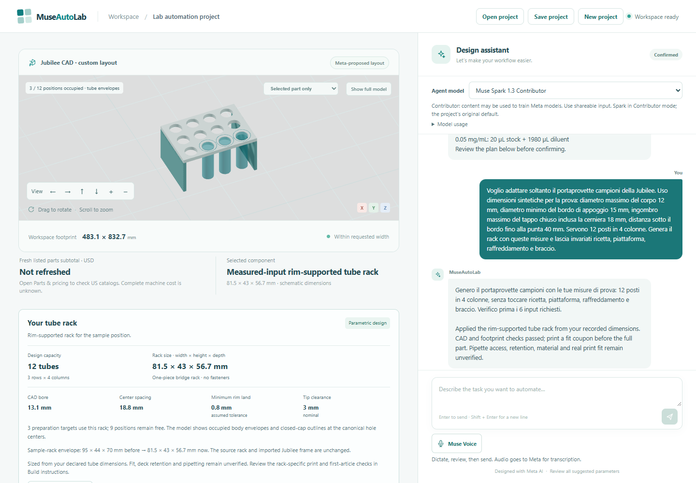

# Delivery verification — 2026-10-30

## Latest module: dimension-driven tube rack

The current increment connects declared tube dimensions in chat to the Jubilee
sample rack, canonical viewer geometry, a scoped part list, immediate instructions,
portable state, and individual rack/fit-coupon CAD files. The
[curated verification record](examples/parametric-rack-verification.json) retains
the exact frozen dataset, working-tree fingerprints, failures, usage and limits.

The **first frozen real-Meta round failed all six supported cases**: the dimensional
source validator rejected correct values quoted in ordinary multi-fact phrases.
The impossible-rim case also returned an extraction error; the unsupported-capacity
case preserved the project. None produced an accepted incorrect rack. The source
parser was repaired to bind each number to its physical field without allowing
swapped dimensions, ambiguous values or volumes to stand in for measurements.

A second round made fresh real Contributor requests against the **same inputs**:
**6/6 supported cases and 2/2 negative cases passed**. It covered English/Italian,
millimetres/centimetres, 6/7/8/12 positions, a partial final row, explicit footprint
and clearance, and one predeclared missing-dimension clarification. Accepted
results preserved the other components and preparation requirements and passed
guide/geometry/Save/Open consistency checks. This is regression evidence after a
known failure, not an independent generalization benchmark. A separate new-request
set and human technical-use comparison remain future work.

Both rounds used nine actual calls: **18 calls, 295,199 reported tokens** total.
All usage fields were retained; monetary charges and remaining credits were not
checked. No inference was made for browser screenshots or the final package.

The evaluation harness defaults to a dry run. For reproduction from the repository
root, run `.venv/Scripts/python.exe scripts/evaluate_labware.py --dataset docs/examples/labware-evaluation-cases.json`
with the pinned environment. Adding `--live --max-calls 12 --output <new-output-directory>`
makes actual requests using separately configured Meta access. Outputs are never
overwritten. Each round freezes source and input hashes; recorded responses may
also be replayed without new inference. Live model responses are not deterministic.

Final regular suite: **704 passed in 70.45 seconds**. Ruff, production build and
three browser flows (rack, scene focus, resources) passed. The rack flow checks
missing measurements, a 6-to-12-position edit, exact rollback, occupied/free
positions, stale guide rejection, save/reopen, mobile layout and the unavailable
operating preview. These are agent checks, not external-user research. Earlier
source-CAD tests retain their original dates; one new complete package was checked
for this module instead of rerunning all eight historical heavy source tests.

The real S2 case was confirmed as revision 12. Its **80,422,680-byte** archive has
29 manifest-listed files plus the manifest. Every file hash, guide, BOM and rack
specification matched the accepted revision. The full STEP reopened as valid with
**860 solids**, preserving the original 809 source solids and 120 mm bed pose.
The rack and coupon each reopened as one valid solid; all 12 rack bores and the
coupon bore passed actual geometric probes, including bearing material checks.
Complete generation/download/verification took 339.92 seconds; that is not a
measurement of generation time alone. No second CAD generation was required.

The example uses **synthetic dimensions**, not measurements of a commercial tube.
The rack measures 81.5 × 43 × 56.7 mm (width × height × depth), with 13.1 mm bores
and 18.8 mm spacing. Three preparation targets occupy twelve available positions.
Download the [confirmed project](examples/parametric-tube-rack-project.json),
[rack STEP](examples/tube-rack/tube-rack.step),
[rack STL](examples/tube-rack/tube-rack.stl),
[coupon STEP](examples/tube-rack/tube-rack-fit-coupon.step) or
[coupon STL](examples/tube-rack/tube-rack-fit-coupon.stl).
[Artifact hashes](examples/tube-rack/manifest.json) and the
[input/build guidance](procurement-and-instructions.md#parametric-tube-rack) accompany them.
Actual fit, print performance, stability, cleaning, deck retention and pipetting
remain unverified. Custom fabrication is unpriced.

## Earlier core journey

The earlier core digital demo passed the software and package checks below. Three varied
fresh Meta journeys have now completed. The third completed through the actual browser
on October 30 after explicit equipment clarification, followed by a real impossible-width
rejection that preserved the confirmed project. The earlier incomplete attempt remains
recorded. These are bounded integration observations, not a model-reliability benchmark
or laboratory validation.

Start with the [reviewer guide](demo-guide.md) and the
[video project](examples/demo-video-project.json). Opening that project and generating
its files need no API key. Fresh conversation requires separately configured Meta
access. The [three-minute captioned video](video/README.md) is available publicly;
the interactive product runs locally.

## Software and reconstruction

| Check | Observed result | Scope |
| --- | --- | --- |
| Final regular Python suite, October 30, after pricing/instructions and document readability fixes | **586 passed**, 67.46 s | Backend, current supplier adapters, freshness/revision/report guards, instructions, model context and previous multimodal regressions; excludes the heavy source suite |
| Source-CAD tests, October 30 | **8 passed** within the earlier **591-test full run**, 749.47 s for that full run | Original source geometry, STEP export/reopen, bed pose, independent standalone regeneration and altered-source rejection; not a separately measured eight-test runtime |
| Ruff | Passed | `app`, `tests`, `scripts` |
| TypeScript / Vite production build | Passed | Production frontend compilation |
| Three current browser flows | Passed | Pricing/instructions, both platform engineering routes, and project files; expiry, safe rereads, failed refresh, downloads, revision guards, chat navigation and mobile |
| Eight earlier multimodal browser flows, October 30 | Passed at that milestone | Foundation, engineering choice, general platform, vision, scene focus, project files, multimodal lifecycle and scene accessibility; explicit offline Meta fixtures, real app/API where required by each test |
| Isolated Windows reconstruction | Passed | New Python and JavaScript environments from unchanged locks; dependency/environment checks, production build and actual recorded-project open/re-save without credentials |
| Recorded-project browser review | Passed | Revision 9, real local source meshes, retained accepted proposals and 100/50/10 µL stock volumes; no new model request or page error |

The final regular suite contains **586 tests**. The earlier full run in this phase
passed 591 tests, including all eight source-CAD checks; three additional regression
cases and the final document-layout change were subsequently covered by the final
regular run. Source geometry, the CAD compiler and dependency locks remain unchanged.
Runtimes are single-host observations,
not performance targets. The isolated environment used the same PC and
permitted existing package caches; it is not a second-machine or cache-cold benchmark.
The no-key review exercised the actual saved-project path rather than substituting
model responses. It does not establish fresh conversational behavior.

An initial restricted installation could not resolve the npm registry; the unchanged
locked installation passed with network access. Earlier restricted test attempts had
temporary-file permission failures. These environment failures remain in local logs.
A FastAPI/Starlette HTTPX deprecation warning and Vite bundle-size warning remain;
they did not fail the checks. No dependency versions were changed for this delivery.

Reproduction commands are in [Verify the product](../README.md#verify-the-product).
The browser project-files test uses controlled export fixtures to exercise reconnect,
guide display and revision guards. A final desktop check at 1440 × 1000 verifies that
opening the guide disables the overlapping sticky model and closing it restores the
normal viewer behavior; the 390 × 844 mobile check also passed. It is separate from
the actual heavy package check.

## Video project's actual package

The original package evidence below is retained. The **current pricing/instruction
package check** is in the next section; it uses the same recorded project and adds
the bound procurement snapshot and Markdown guide.

## US catalogs, instructions and current package

The [curated verification record](examples/procurement-instructions-verification.json)
contains actual primary-source observations and the real Meta question/answer.
The full recorded revision-9 project retrieved **8 fresh prices across 15 groups**:
six candidate Jubilee kits and two selected cooling components, totaling **USD
591.86**. Seven groups remain unpriced. This is a dated partial subtotal, including
candidate offers for review, with shipping/tax/fabrication and other unknowns excluded.
An independent smaller project returned six priced foundation candidates, USD 546.96.
The supplier registry contains fifteen exact SKU/variants; a selected project uses
only applicable entries. No unrestricted search, supplier login or purchase occurred.

One real Contributor request through the app explained the current report and opened
**Build instructions**. The response distinguished missing costs and unresolved
interfaces; revision 9, confirmed state and all thirteen portable canonical fields
remained unchanged. No additional model request was made. Token counters were not
retained by this UI-only capture, so consumption is unknown rather than estimated.
These observations are separate from the twelve earlier multimodal requests below.

One actual full export produced an **80,351,596-byte ZIP**, SHA-256
`2f6f1a809fa840f691f10d8e3e40a798fbbc2897fcbda8b2786df7c923b09047`, with **26
manifest-listed files plus the manifest**, ten guide steps and nineteen canonical
components. All file hashes, immediate/packaged guide JSON/HTML/Markdown, BOM CSV,
procurement JSON, source STEP hash and lineage/revision matched. Its exported STEP
reopened valid with **863 solids**, retained source bounds and original bed hierarchy.
Simulation remains `not_run`. An initial status connection failed during native CAD;
the check reconnected to the same job and completed without a second generation.
The resumed verification took 263.88 s, excluding the initial attempt's elapsed time.

The final visual pass replaced a cramped twelve-column procurement table with
readable per-item cards. Desktop, phone and print views have no page overflow or
browser error. The final standalone HTML was rendered and reviewed; JSON/Markdown
remained byte-identical to the checked ZIP. The ZIP hash above precedes this HTML-only
style change; unchanged CAD was not regenerated just for styling. The final regular
suite and document/export tests cover the final source. See the [user flow and limits](procurement-and-instructions.md).

## Earlier video-project package evidence

The app reopened the third fresh journey's own saved project and generated a new
package with no Meta credentials configured. Exactly one export request ran. It
retained the same logical project, confirmed revision 9, 120 mm bed pose, 8 °C target,
inspection extension and 200/100/20 µL stock volumes. This is separate from the
earlier recorded example below.

| Property | Observed value |
| --- | --- |
| Generation time | 137.757 s |
| ZIP / expanded size | 80,319,463 / 408,897,507 bytes |
| File count | 25 |
| ZIP SHA256 | `f4f4232e28dacaebf3195ee95d70310cc916756f739a0f6abff2f37e2c23212a` |
| Consistency | All manifest byte sizes/hashes, input identity, project lineage and revision checked |
| Reopened STEP | Valid; 863 solids and 19 named components; original bed and arm/camera present |
| STEP reopen time | 211.34 s; no independent regeneration of this exact final package |
| Guide | Actual iframe and download; 9 SVGs × 19 legend entries within bounds |
| Simulation | `not_run` |
| Page errors / new Meta requests | 0 / 0 |

The uncut export recording is 151.16 s at 1440 × 1000, 25 fps and contains the entire
real generation wait. The edited video identifies any omitted waits. Its portable
project SHA256 is `e57412d1b784d21385987dba00bdec9911cc8ef930de62433287b7452a1c4dc2`.
An initial helper comparison stopped before any export request; it was corrected to
compare persisted extension fields with their rebuilt counterparts. The original input
was unchanged and only one CAD export ran.

## Earlier verified package

The app reopened the earlier recorded real-Meta project, confirmed revision **9**, and generated
the package through its ordinary UI on October 30. No Meta call or export fixture was
used for this check.

| Property | Observed value |
| --- | --- |
| Generation time | 154.44 s |
| ZIP / expanded size | 80,319,470 / 408,898,338 bytes |
| File count | 25 |
| ZIP SHA256 | `78f0453cbdcdb81e135dd0868cc10c1af76d85275e63a861f29a4ac4977bd25c` |
| Package consistency | Manifest hashes and project/revision references matched |
| Reopened STEP | Valid; 863 solids across 19 named components |
| Source pose / expansion | 130 mm recorded bed drop; actual bed geometry and arm/camera group checked |
| Assembly guide | All 19 legend entries inside each of 9 SVG view boxes; actual inline guide and HTML download exercised |
| Standalone guide at 390 px | No horizontal page overflow |
| Browser errors / new Meta calls | 0 / 0 |

The final STEP reopen took 209.239 s. It did not independently regenerate that exact
final package; standalone source regeneration is covered by the separate heavy suite.
This archive hash identifies one observed export. Reopening creates new runtime IDs,
so a newly generated package is not expected to have identical ZIP bytes. The portable
example SHA256 is `29aedcf73b7191698b3d405ae905311fb808b61a3a55d2cd2438b2c555ad7489`.

The approximately 80 MB archive is generated locally, not stored in Git. The repository
contains the portable example and instructions needed to reproduce it. Raw test logs,
original model responses, archives and detailed screenshots are retained locally;
private workspace records and credentials are excluded from publication.

## Real Meta rehearsals

### October 30: third complete fresh journey

The [new browser rehearsal](examples/delivery-third-rehearsal.json) completed on the
published application code, using 11 Contributor calls: ten for the core journey and
one for a 450 mm width request. That request was rejected with the entire confirmed
project payload unchanged; conversation history retains the rejected request.

The accepted project lowered the original bed from 100 to 120 mm, retained layout
through an 8 °C cold-bay request, reopened correctly, added the arm/camera, calculated
200/100/20 µL stock amounts and reached confirmed revision 9. The browser reported no
JavaScript errors. Its [portable project](examples/demo-video-project.json) is separate
from the earlier revision-9 example; revision numbers alone do not identify a project.

New usage was 71,961 input plus 6,405 output tokens. Across the earlier and new runs,
there were **68 physical attempts**, 67 provider responses and **480,928 reported tokens**
(428,780 input / 52,148 output), plus the same one historical unknown consumption.
The core chat turns totaled 72.437 s; the negative turn took 5.016 s. This excludes
save/reopen/confirmation overhead and CAD export. The actual browser capture retained
measured waits; its source recording is 108.8 s at 1440 × 1000.

This satisfies the proposed count of three varied fresh complete journeys. The first
preceded final parser hardening and was replayed offline through final checks; the
second and third used the final backend live. It is not a claim of three independent
fresh successes on identical historical code or a statistical reliability percentage.

### October 29: initial rehearsals, retained unchanged

The [curated rehearsal record](examples/delivery-rehearsal-summary.json) preserves the
October 29 outcomes, failures, timings, code fingerprints and usage boundaries:

- 57 physical Contributor attempts; 56 provider responses, all HTTP 200. A valid HTTP
  response does not imply the application accepted its content or completed the journey.
- 356,819 input and 45,743 output tokens reported. One interrupted request has unknown
  consumption; the 402,562 reported total is a lower bound, not billing or credit balance.
- Two complete fresh journeys and one recovered journey. The recovered one does not
  count toward the proposed three-fresh-journey gate.
- The first successful journey's ten recorded responses also passed an offline replay
  through the final parser/compiler checks; replay makes no provider calls and its
  historical token metadata is excluded from live totals. The second fresh run used
  the final backend fingerprints.
- The third fresh scenario omitted explicit equipment ownership. It remained incomplete
  while the application requested clarification; no successful third run is claimed.

Observed failures led to bounded source-text normalization, explicit current layout
context and deterministic checks on requested layout preservation. These guards support
a limited set of preserve/keep/retain/leave clauses, not universal language understanding.
No Meta calls were made during the package/reconstruction checks. The separate October
30 live browser rehearsal above accounts for its own 11 calls.

## Multimodal completion and usability

The account catalogue advertised Spark Contributor, Spark Standard, Wonder, Muse
Voice Transcribe and Muse Image. Actual inference was checked separately. The
[curated request record](examples/multimodal-verification.json) retains all twelve
new calls: **6 text, 4 transcription and 2 image requests**, with no automatic
provider retries. Text responses reported **61,249 tokens**; image responses
reported **11,582 tokens** separately. The transcription endpoint exposes no token
usage. These counts are not an invoice; remaining credit and actual charges were
not inspected. Earlier core-journey totals remain historical and separate.

| Live observation | Outcome and correction |
| --- | --- |
| Spark Standard selection and question about the saved project | Passed; actual reported model matched selection and project was unchanged |
| Wonder saved-project question | Two responses failed strict source validation on ungrounded repeated values. Empty-update guidance was clarified; one subsequent live confirmation passed without changing the project. Validators remain strict; this is not a reliability benchmark |
| Voice revision and silence probes | Correct 20 mm revision text; silence returned empty text. Neither transcription changed a project |
| First browser voice-to-plan attempt | ASR preserved the quantities, but number words such as five and two invalidated the deterministic plan after Send. Added bounded English number/unit normalization with literal-source equivalence checks |
| Final browser voice and explicit Send | Passed after visible removal of a duplicated phrase; plan ready, stock 200/100/20 µL, diluent 1800/1900/1980 µL, confirmed r9 and accepted geometry/arm unchanged; no engineering actions |
| One image utility probe and one real app image | Both completed. App result downloaded byte-identically and retained its reference/revision. Small mechanical details differ, so images are presentation illustrations, not technical drawings |

The final voice recording uses two declared segments: real synthetic microphone
input through the actual AudioWorklet/ASR, then the actual transcript restored in
a reopened copy of the same public r9 project, visibly corrected and sent once.
The split was caused by the test script's narrow correction guard, not an app
failure. There was no second ASR or hidden replacement of the failed earlier r10.
The final ASR and Send observations took 4.297 s and 12.531 s respectively,
including UI/checkpoint overhead. The real app image took 13.281 s. These are
single-run observations, not latency guarantees or acoustic-recognition benchmarks.

Agent usability walkthroughs and offline browser tests verified:

- Failed reset retains work; successful reset provides undo.
- The opening composer is in the first mobile viewport; a populated 390 px page
  stays 390 px wide, with all tested controls inside its bounds.
- Plan/file shortcuts reveal and focus their real sections, including a ready
  draft reopened from the recorded project.
- Keyboard orbit/zoom changes the actual view, visible focus is retained, and
  source-loading/failure states settle correctly.
- Dictation requires review/Send, handles cancellation and late permission,
  preserves an overlong transcript and stops microphone tracks.
- Illustration cancellation, stale revision and error paths preserve the project;
  opening its section stops the sticky scene from obscuring the result.

This is agent-driven usability testing, not external participant research. The
full 539-test suite passed after quantity fixes. The last UI change was the scoped
sticky-scene CSS rule; the full multimodal browser flow and production build passed
again afterward. Other application source stayed unchanged during the final voice
check. Source geometry and export logic are unchanged, so historical heavy-CAD
checks were not repeated.

## Three-minute demo video

The publicly published MP4 records the earlier core journey with English captions.
Final-video work is deferred until the product improvements are complete. The
current website and verification include later capabilities that the historical
video does not demonstrate. No newer video is claimed published in this update.

## Remaining delivery work

The requested selector, dictation, optional image integration, US catalog retrieval,
instruction generation and usability fixes are implemented and verified in the
scope above. Final-video work remains deferred. The [adaptable submission text](submission-draft.md)
is prepared without entering Cerebral Valley, as requested. Actual form fields,
entrant/track eligibility, declarations and accepted video hosting still require
the entrant's check. No event login or submission has occurred.

Current Jubilee and OT-2 routes have no physics or hardware-control adapter. CAD
validity, layout checks, kinematic sweeps and dilution arithmetic do not establish
mounting, collision clearance, camera coverage, cooling, liquid handling or
laboratory performance. The final event submission remains a separate action.
