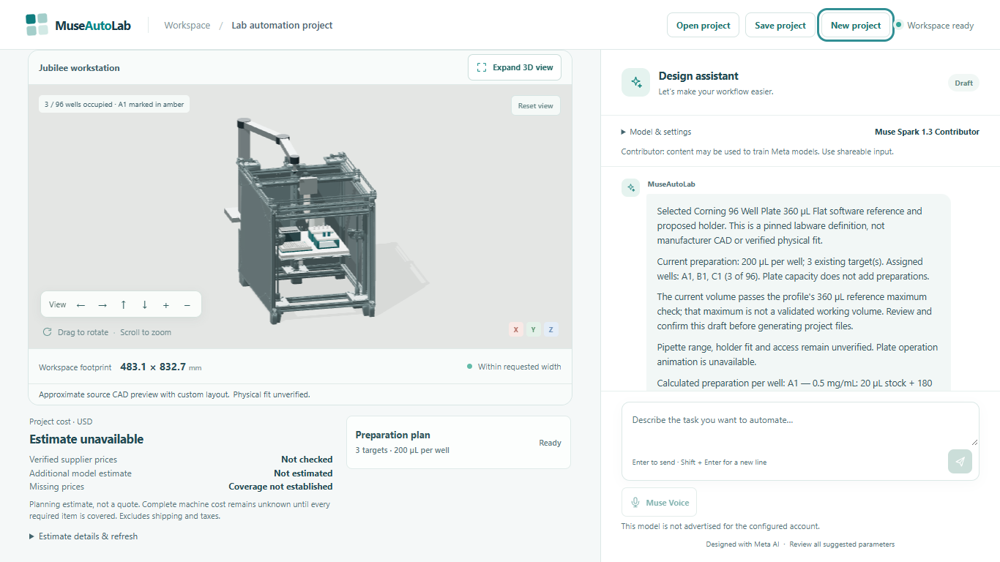
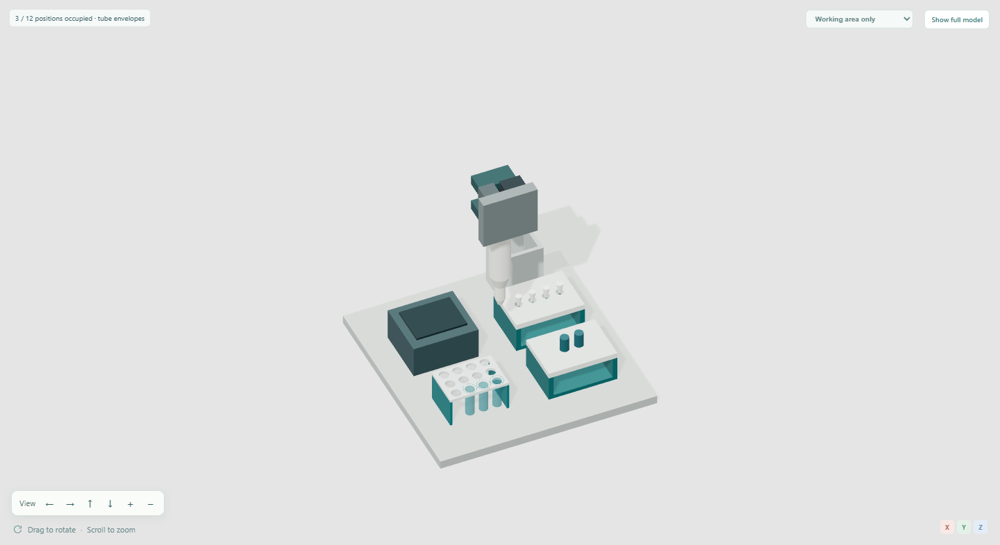

# Workspace quality review

Reviewed 2026-11-02. MuseAutoLab is a platform for designing custom laboratory automation setups; liquid preparation is the implemented example used for these checks.

The review used the real React interface, local API/compiler and headless Chrome with deterministic synthetic model responses. The checks below made no Meta inference, supplier refresh or purchase calls. They establish browser behavior, not usability with human participants or laboratory performance.

## Changes and observed results

Long assistant replies previously opened at the bottom, hiding their introduction. They now open at the beginning when taller than the chat viewport; short replies remain fully visible. Request-status changes preserve the reader's position. The regression exercises short and long replies and a failed request while reading earlier messages. In one reduced-motion capture, a 362 px reply opened 16.25 px below the top of a 307 px chat viewport.

Desktop captures at 1366 × 768 and 1440 × 900 and an emulated 390 × 844 mobile viewport showed no document overflow. Build instructions and software guidance remained reachable on mobile. The scene-focus regression now explicitly selects the mobile Design tab after resizing: its previous failure came from trying a control while Chat was active, rather than a missing model control.

General workflow discovery retains a nonnumeric cost placeholder. The updated platform regression checks that general planning exposes no machine, preparation or camera, emits no cost-estimate request before an accepted design, and exports a general brief without fabricated design data. It then exercises the liquid-preparation route, explicit Jubilee design, confirmation and return to general planning. Returning clears the machine and preparation without starting another estimate.

Small secondary text was too pale because later base styles overrode the accepted workspace styles. The original declarations now use the existing teal text color. Measurements from computed foreground and background colors were:

| Normal-size text | Before | After |
| --- | ---: | ---: |
| Cost caption | 3.00:1 | 4.66:1 |
| Cost scope note | 2.46:1 | 4.66:1 |
| Message author | 3.42:1 | 4.98:1 |
| Composer keyboard hint | 1.92:1 | 4.98:1 |
| Chat subtitle | 2.77:1 | 4.98:1 |

Primary cost text measured 8.93:1 and sampled header buttons 5.40:1. The placeholder now uses the same secondary text color on white. A keyboard Tab check from Save project to New project produced a visible solid 3 px focus outline. These are targeted checks against the 4.5:1 normal-text threshold, not a full accessibility certification; disabled controls were excluded.

The synthetic desktop capture shows a liquid-preparation example. “Estimate unavailable” is an intentionally stubbed result, not a measured machine price.

The final 3D presentation uses the revised camera framing while preserving source geometry. Full-model, working-area and component views were inspected with tube, plate and alternative tip-rack examples. The scene-focus regression exercises isolation, manual orbit, full-model return and reset on revision or selection changes. This does not establish physical fit, collision safety or control support.

Working-area isolation is a viewing mode; it does not remove parts from the project or its exports.

## Verification

Passing browser checks: `tests/browser_chat_scroll.py`, `tests/browser_chat_feedback.py`, `tests/browser_platform.py` and `tests/browser_scene_focus.py`. Additional isolated captures checked responsive layout, reduced-motion chat behavior, instruction/software navigation and absence of browser page errors. Ruff passed on the three new or updated regression files.

Impeccable skill 4.8.0 was used with engine 0.1.18. The final source detector retained the same six findings: two functional warning cues, two cascade overrides and two pre-existing decoration candidates. This source scan is separate from the rendered review and is neither a usability result nor an accessibility certification.
